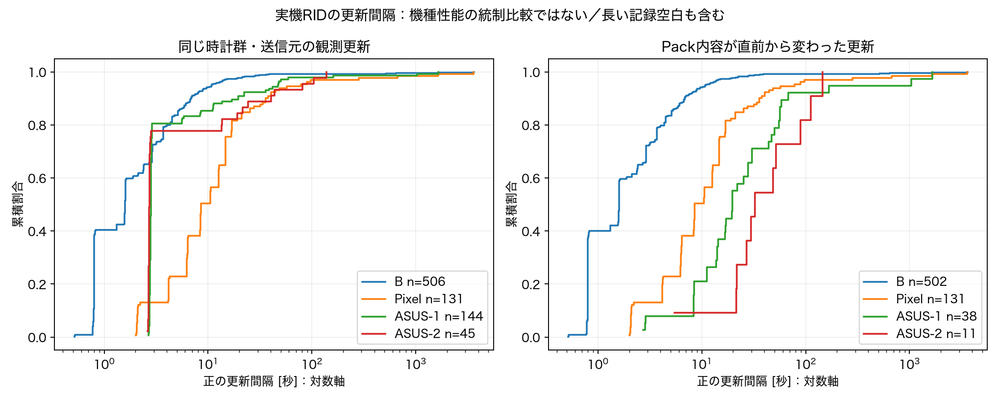
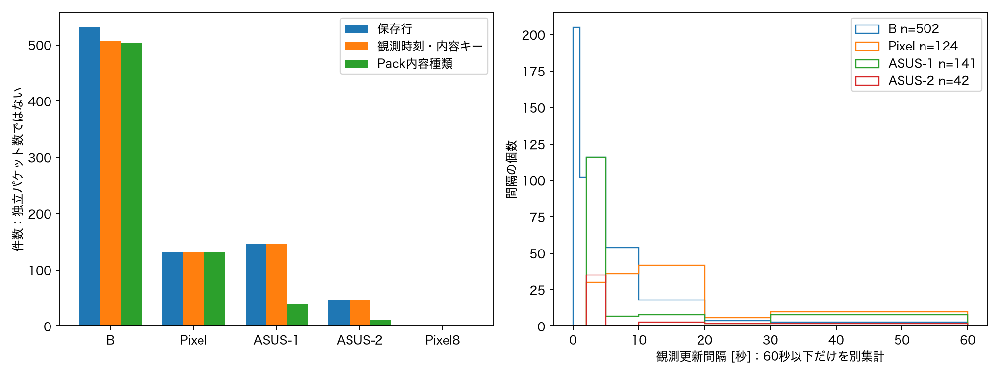
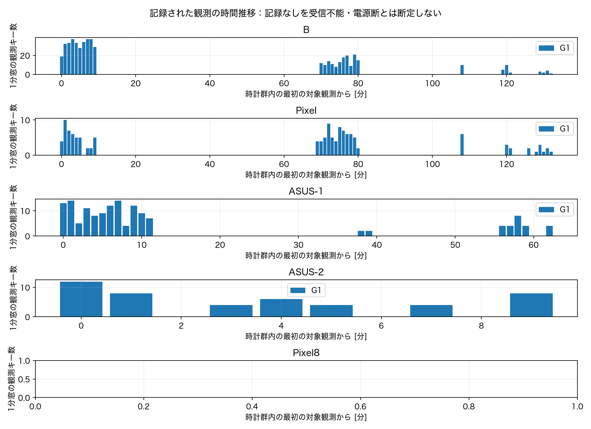

# Issue92：Pi／Androidの取得間隔と重複・内容反復

## 今回確認できたこと

対象実機の保全済みデータを読み取り専用で解析した。スキャン要求の周期、保存周期、新しい観測時刻、新しいPack内容は別の指標である。特にASUSでは、新しい観測時刻で保存されても、直前と同じPack内容が繰り返されていた。

| 端末 | 保存行 | 観測キー | Pack内容種類 | 観測更新中央値 | 内容変化の間隔中央値 |
|---|---:|---:|---:|---:|---:|
| Pi B | 531 | 507 | 503 | 1.59秒 | 1.59秒 |
| Pixel 6 Pro | 132 | 132 | 132 | 8.52秒 | 8.52秒 |
| ASUS-1 | 146 | 146 | 40 | 2.81秒 | 19.69秒 |
| ASUS-2 | 46 | 46 | 12 | 2.72秒 | 32.44秒 |
| Pixel 8 | 0 | 0 | 0 | 対象記録なし | 対象記録なし |

Pixel 8には一般Wi-Fi観測があるが、今回指定した実機IDの参照デコード成功行はなかった。これを全電波未受信、測位失敗、受信率0%とは扱わない。

## 集計方法と分母

- 対象は公式参照デコーダで対象申告IDと一致した行。Protocol 0のオフライン解析であり、本番の受理条件を緩めていない。
- 端末・boot_scope・UTC−monotonicの対応群を分け、その中の送信元・周波数ごとに単調時刻で並べた。UTC−monotonicの対応は起動IDの独立証明ではない。
- 観測キーは送信元・周波数・観測monotonic時刻・内容ダイジェスト・Pack内容の組合せ。同キー反復を除外した。Bの24行が該当する。保存時刻等を含む行全体の完全一致や、物理パケットの重複とは同一視しない。
- 同じ内容でも観測時刻が変われば別の観測キー。連続する同内容を新しいPack内容とは数えない。ただし再送・キャッシュ・新しい受信で内容が同じ場合を、この情報だけで識別できない。
- 内容がA→B→Aと変われば変化イベントは3回、内容種類は2種類。内容の変化は位置更新や物理送信を直接証明しない。
- 間隔の分母は同じ時計群・送信元内の正の隣接間隔。最初の記録は間隔の分母にならず、複数送信元の場合は保存行数−1とも一致しない。

対象855保存行の時刻不明・cache_stale=true・鮮度不明はいずれも0行だった。一般Wi-Fi全体の鮮度不明や測位欠測まで0という意味ではない。無効なUTC、未取得・非有限・非正monotonicは間隔計算から保留する。

## 図と長い空白の扱い



左は観測キーの更新、右はPack内容変化の間隔。横軸は秒の対数軸、縦軸は間隔の累積割合。同じ内容を保存する頻度だけでは、新しい内容の取得間隔を説明できない。



全間隔には長い空白も含む。観測更新のp95／最大はB 10.78秒／3617.62秒、Pixel 67.67秒／3580.11秒、ASUS-1 46.15秒／1650.79秒、ASUS-2 73.64秒／137.69秒。別に60秒以下の分布も出力したが、60秒は原因を判定する閾値ではない。長い間隔を都合よく削除して端末性能を説明しない。



各端末の時計群内の最初の対象観測を0分とした。**横軸0分は端末間で同一時刻を意味しない**。記録のない区間を電源断やRF未受信とは断定できない。

## 比較できないこと

端末の位置・OS・アプリ版・スキャン設定・取得期間が統制されていない。#89の共通時刻は対応候補にとどまるため、ここでは共通窓の公平比較、端末順位、PDR、パケット欠測率を算出しない。送信総数も不明。標準Wi-Fiスキャンから全Beacon取得や常時1Hzを主張できない。

## 実装・再現・テスト

```sh
.cache/week26-mac-venv/bin/python week29/scripts/audit_rid_intervals.py \
  --config captures/week29/issue92-input-private.json \
  --private-output captures/week29/issue92-intervals-a \
  --output week29/results/issue92-intervals-a
python3 -m unittest discover -s week29/tests -v
```

入力設定には非公開の対象IDファイル、各端末の参照デコードJSONLを指定する。解析前後の入力SHA-256一致を確認し、入力manifestと行単位データはignored `captures/`に保持した。公開用は[集計JSON](results/issue92-intervals-a/summary.json)、個別間隔CSV（公開版には含めない）、[時間窓CSV](results/issue92-intervals-a/observation-time-bins.csv)。実測の匿名記述統計であり、合成的な受信性能の結果ではない。

新しい合成fixtureテスト5件で、同一観測キー、同内容の反復、以前の内容への復帰、boot／時計対応の変更、不明・非有限monotonic、送信元をまたぐ誤った間隔を確認した。Week29全42件成功。コード公開とCI確認は未実施。共通窓の確定と条件を統制した実験は残件として扱う。
