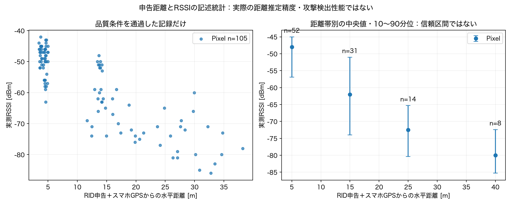
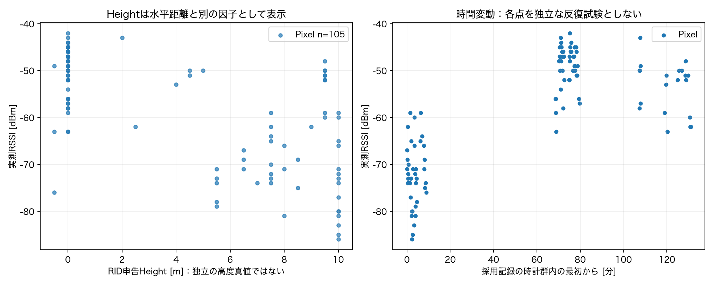

# Issue94：申告水平距離と実測RSSI

## 入力条件を通過したのはPixelの105行

#91で同端末内の時刻・自己位置対応を検査し、さらに「OS申告水平精度20m以下、かつ精度／申告水平距離が0.25以下」を探索的採用条件にした。Pixel 132行中105行を採用し27行を保留、ASUS-1の146行とASUS-2の46行は全て保留した。Pixel 8は対象機体の記録がない。

この条件は実際の誤差を保証しない。距離はRID申告位置とスマホ自己位置の水平距離。独立した真距離ではない。Bの設置座標は不明なので距離を算出しない。高度基準の整合が未確認のため斜距離も算出しない。



この105行では、申告距離が大きい帯ほどRSSI中央値が小さかった。0〜10m帯52行、10〜20m帯31行、20〜30m帯14行、30〜50m帯8行。ただし、同じ距離帯でも大きなRSSI変動がある。図の縦棒は10〜90分位の分布幅であり、信頼区間ではない。



Heightは別因子として示す。時間によってもRSSI分布が変わっており、距離だけの効果を識別した結果とはいえない。姿勢・遮蔽・電力・受信機差のどれが原因かを、このログだけで断定しない。

## 今回適用しなかったもの

独立run・送信電力管理・位置真値が確立していないため、距離減衰モデルの学習、汎化精度、モデル残差の検証は実施していない。連続105点を独立105試験として信頼区間や検出性能を算出しない。今回の結果は実測の記述統計まで。後続の[Issue96](20_Issue96_実測RSSIへの合成攻撃と時間分割での失敗結果.md)では、同一端末内の時間分割による条件付き代理モデルを別途試し、未改変の警報が48.15%となった失敗結果を記録した。独立runへの汎化が検証できたわけではない。

この図だけからRSSIによる距離推定が高精度、位置偽装を検出できる、端末間で共通モデルが使えるとは結論しない。

## 再現

```sh
# 先に報告15の品質監査を実行して非公開の派生CSVを生成
.cache/week26-mac-venv/bin/python week29/scripts/analyze_claim_distance_rssi.py \
  --positions captures/week29/issue91-position-a/target-position-quality-private.csv \
  --output week29/results/issue94-distance-a
python3 -m unittest discover -s week29/tests -v
```

[集計JSON](results/issue94-distance-a/summary.json)、[距離帯CSV](results/issue94-distance-a/distance-bins.csv)、[Height帯CSV](results/issue94-distance-a/height-bins.csv)を出力。入力前後のSHA-256一致、採用境界・欠損／非有限値・空の区分をテスト。PNG2枚を目視確認した。Week29全49件成功。コード公開・CIは未実施。
