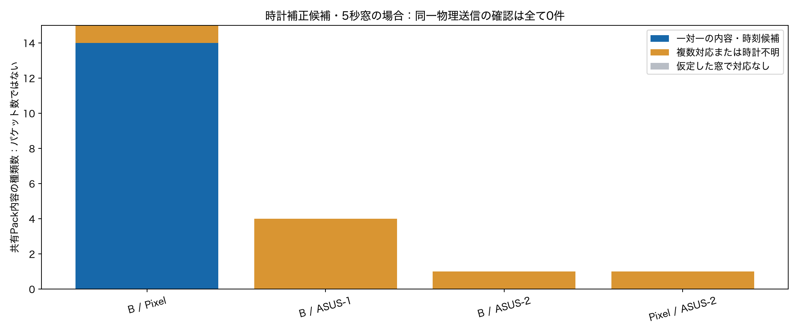

# Issue95：同一送信候補と局間RSSI差の成立条件

## 結果

対象実機のPack内容を照合し、B–Pixelで15種類、B–ASUS-1で4種類、B–ASUS-2で1種類、Pixel–ASUS-2で1種類の共有内容があった。物理的に同一送信と確認できた組は0件。



時計補正候補の範囲と5秒の許容窓を仮定すると、B–Pixelは14種類が一対一候補、1種類が複数対応。ASUSを含む共有内容は複数対応になった。Bの同一観測時刻・内容の再保存24行はこの照合では除外したため、保存行をそのまま使う以前の分類とは一対一の件数が異なる。

青色の一対一候補も同一物理送信の確認ではない。時計補正は内容一致から導いた仮説であり、独立した同期精度の検証ではない。これを独立証拠として同一送信を確認すると循環になる。

## 保存されていた情報

| 情報 | B | Androidの対象記録 | 意味 |
|---|---|---|---|
| BSSID・Packダイジェスト・観測時刻 | あり | あり | 送信元・内容・時刻の候補照合 |
| ODID counter | あり | 未取得 | B側だけ。折返しや再送もあり物理送信の証明ではない |
| Beacon TSF・802.11 sequence control | 未取得 | 未取得 | 独立したフレーム照合ができない |
| boot_scope | 対象行に未記録 | あり | Bの時計対応は起動ID確認とは別 |
| キャッシュ鮮度フラグ | あり | あり | 古くないという記録でも同一送信の確認にはならない |
| 時刻不確実性の数値 | 未取得 | 未取得 | 5秒窓を実機同期精度とみなせない |

[取得可否CSV](results/issue95-matches-a/field-availability.csv)は**非null行数**。`physical_packet_match`もフィールド自体があることを数えているだけで、true件数や確認成功数ではない。

## 窓と時計補正の感度分析

許容窓0.1／1／5／30／60秒と、相対時計補正への−5／0／+5秒の摂動を組み合わせ、[CSV](results/issue95-matches-a/window-sensitivity.csv)に全条件を出力した。時計候補範囲と許容窓が交わる組を候補とし、同内容が複数回あればambiguousを保持する。どの窓でもmatched_confirmedには昇格しない。共有内容がないものと、共有内容があるが仮の窓では対応しないものは別の集計。

## RSSI差を評価しなかった理由

同一送信なら `R_i = P_t − L_i + b_i + ε_i` から局間差で共通の`P_t`を消せる。しかし同内容の別送信では`P_t`が異なり得る。また同一送信でも受信機偏差`b_i`と雑音は残る。

今回、同一送信が確定せず局間ゲインも未校正なので、共通電力相殺としてのRSSI差分布・偏差・時間変動はNOT_EVALUABLEとした。候補のRSSIを差し引いて、同一送信の実測DRSSとして発表しない。非同期・別パケットの単一RSSIの限界も解決していない。

## 再現・検証

```sh
.cache/week26-mac-venv/bin/python week29/scripts/audit_packet_candidates.py \
  --config captures/week29/issue92-input-private.json \
  --clock-summary week29/results/issue89-time-audit-c/clock-candidates.json \
  --private-output captures/week29/issue95-matches-a \
  --output week29/results/issue95-matches-a
python3 -m unittest discover -s week29/tests -v
```

入力前後SHA-256一致を確認。内容・時刻・BSSIDを含む照合台帳と入力manifestはignored `captures/`のみ。新規テスト5件で同内容反復、近時刻でも未確認、clock jump／不明、窓と補正摂動、送信元不一致を確認した。counter一致・折返し値が同じでも確認へ昇格しないことをテストした。Week29全54件成功、PNG目視確認。コード公開・CIは未実施。
