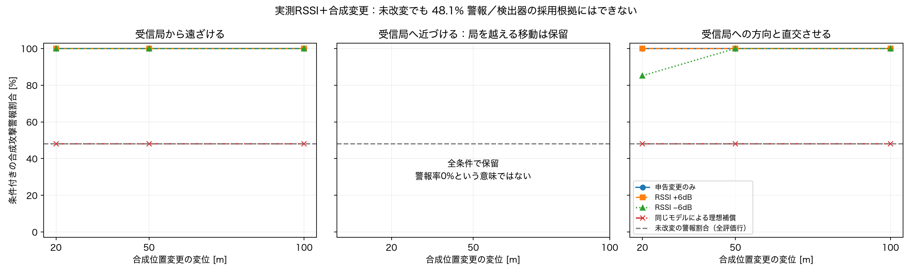
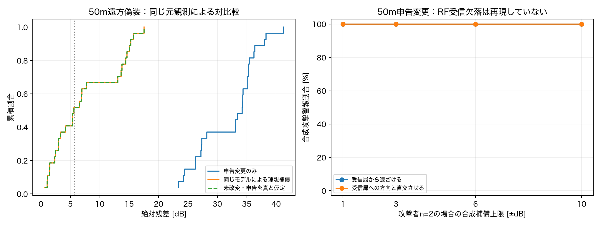

# Issue96：実測RSSIへの合成攻撃と時間分割での失敗結果

## 結論：今回のモデルを検出器として採用する根拠は得られなかった

Pixelの品質条件通過105行を時系列で学習52行・閾値校正26行・評価27行に分けた。校正残差の95分位を閾値にしたが、**評価区間では未改変でも13/27行（48.15%）に警報が出た**。「未改変のRID申告を真と仮定した基準」での値であり、独立真値で確かめた実際の誤警報率ではない。

時間・条件による分布変化に対して正常相当の警報を十分抑えられておらず、合成攻撃で高い警報割合が出ても優れた検出性能とはいえない。評価値を見て閾値を調整し直すことはしていない。

## 実測と合成の境界

実測部分：保存されたRSSI、機体のRID申告位置、時刻対応を検査したスマホ自己位置。

合成部分：申告位置の水平移動、RSSIへのdB加算。実際の送信電力制御や、その結果生じる受信欠落は再現していない。位置の独立真値がないため、以下はモデル整合性の代理評価であり、実機攻撃の検出性能ではない。

機体とスマホの高度基準が整合していないため水平距離だけを使う。高度偽装・3D距離は保留。ASUSは位置品質条件を通過せず、Bは設置座標不明なので対象外。Pixel 8は対象実機IDの観測なし。

## 分割とモデル

- 時刻順の前半50%を学習、次25%を校正、後25%を評価。ランダム行分割は行わない。同一boot内に限定。
- 各分割境界の10秒以内を除外する処理を設けた。今回の境界は既に10秒超離れており、除外は0行。
- `RSSI = a − 10 n_h log10(d_horizontal)` を学習区間のみで当てはめた。`a ≈ −30.175dBm`、`n_h ≈ 3.111`。この`n_h`は水平距離に対する代理モデル係数であり、物理伝搬指数を確定した値ではない。
- 校正区間の絶対残差95分位`5.644dB`を固定閾値にした。評価区間を学習・閾値設定に使っていない。
- 独立した飛行runは確立していない。30秒ブロックごとの件数・警報割合を別CSVに出したが、これも独立runではない。パケット独立の信頼区間や独立runのbootstrap CIは算出していない。

## 合成攻撃条件

変位20／50／100mについて、受信局から遠方、近方、受信局への方向に直交する移動を定義。同じ元の評価記録を使って対比較した。

元の申告水平距離を`d`、変位を`δ`とすると、遠方は`d+δ`、近方は`d−δ`、直交方向は`sqrt(d²+δ²)`。近方で`d<=δ`の場合は受信局を越える別の条件になるため保留し、距離を小さな正数に勝手に丸めない。

電力条件は、申告変更のみ、一定+6dB／−6dB、振幅6dB・周期60秒・位相0の正弦変動、同じモデルに一致する上限なし補償、攻撃者`n=2`かつ補償上限±1／3／6／10dB。乱数を使わず、元データ・分割・全式で結果が決まる。



遠方の申告変更だけでは27/27行が警報になった。しかし基準の警報も13/27行あり、この100%を検出成功の証拠として強調しない。近方は全評価記録で元の距離が20m以下のため、全条件保留。0%の検知率ではない。

50／100mなどの申告変更は学習距離域を外れる場合がある。各条件の`modified_distance_extrapolation_fraction`をCSVに記録しており、未学習距離への外挿を高い検出能力と混同しない。

## 理想補償で消えるもの

同じモデルを知る攻撃者が、変更後の申告距離`d'`に対して、

`ΔP = −10 n_h log10(d'/d)`

をRSSIに加えると、符号付き残差は元の値と一致する。

`(R + ΔP) − f(d') = R − f(d)`



従って、この合成条件では理想補償後も未改変と同じ13/27行が警報となる。これは理想モデルの数理的性質を実装で確認したもので、実環境の攻撃者が必ず完全補償できると示したものではない。逆に`n=2`・±10dB以下の補償では今回の50m変更に対し警報が残ったが、モデル誤差、必要補償量、外挿の影響を含む単一条件の結果である。

## 成果物と再現

```sh
.cache/week26-mac-venv/bin/python week29/scripts/evaluate_claim_attacks.py \
  --positions captures/week29/issue91-position-a/target-position-quality-private.csv \
  --private-output captures/week29/issue96-attacks-a \
  --output week29/results/issue96-attacks-a
python3 -m unittest discover -s week29/tests -v
```

- [条件・分割件数・未改変警報](results/issue96-attacks-a/summary.json)
- [81条件の対比較・分母・保留・外挿割合](results/issue96-attacks-a/attack-summary.csv)
- [30秒ブロックごとの記述統計](results/issue96-attacks-a/time-block-rates.csv)
- 非公開：`captures/week29/issue96-attacks-a/`のモデル分割入力・元観測との対比較CSV。

原本のSHA-256不変を確認。数理的補償の残差一致、変位の幾何、近方の保留、補償上限、時間分割と境界除外、boot混合拒否、合成モデル復元をテストした。Week29全58件成功、PNG2枚を目視確認・保留表示と未改変警報の注記を改善した。コード公開・CIは未実施。

次の判断には独立飛行run・位置真値・送信電力条件・姿勢／遮蔽の記録が必要。同一送信多局の共通電力相殺も#95の条件不足で未評価。今回の代理評価は、これらを解決したものではない。
