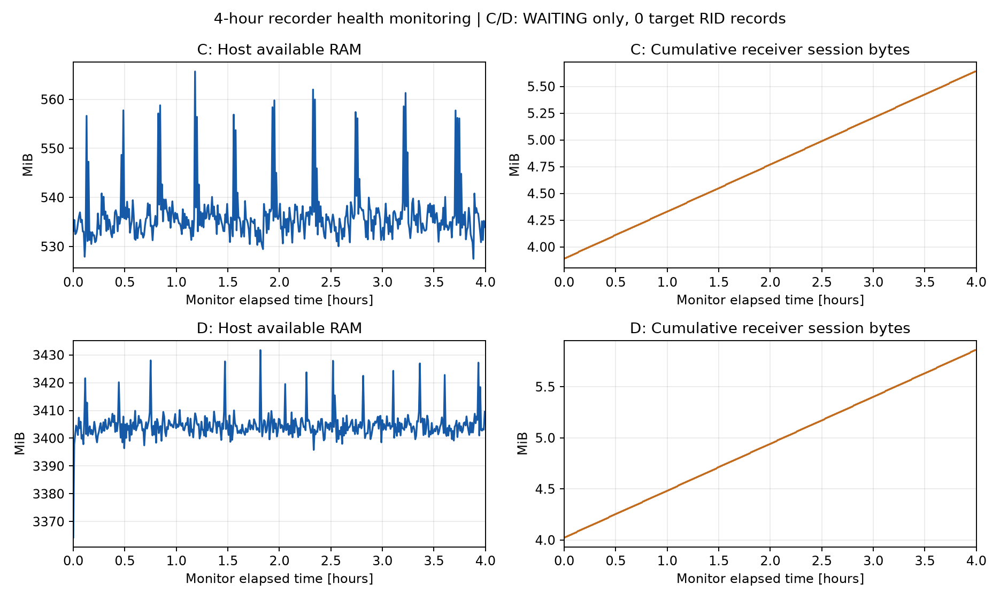

# C・D：4時間監視結果の回収（2026-11-19）

## 結果

C・Dの4時間監視結果を実機から回収した。両台とも14,400秒の予定時間を完走し、収録healthのFAULTは0件、監視サービスのResult=success・終了コード0だった。回収時もreceiverサービスはactive。

**全監視サンプルがWAITING、対象RID記録は0件だった。実ドローンの受信成功や飛行時の保存容量を証明する試験ではない。**

| ノード | 監視時間 | サンプル数 | FAULT | ホスト空きRAM最小 | SD空き最小 | 観測した受信セッション累積量最大 | 対象RID記録 |
|---|---:|---:|---:|---:|---:|---:|---:|
| C | 4.00時間 | 437 | 0 | 527.5MiB | 48.29GiB | 5.64MiB | 0 |
| D | 4.00時間 | 452 | 0 | 3364.3MiB | 19.87GiB | 5.86MiB | 0 |

監視は2026-11-18 18:12ごろ（JST）に開始した。サンプル間隔は30秒待ち＋巡回処理時間であり、厳密な30秒周期ではない。サンプル数の差を機種性能の差と解釈しない。

## グラフ



横軸は監視開始からの経過時間。左はホスト全体のMemAvailable、右はreceiverが報告したセッション累積バイト数。左右・ノード間で縦軸範囲が異なるため、線の傾きや振幅を直接比較しない。

セッションは監視前から動いていたため、右図は「今回4時間だけの保存量」ではない。対象RIDが0件でも診断・状態記録等の保存は存在する。保存対象全体の内訳を今回新たに分解したわけではない。

## 確認できた範囲と限界

- 対象RID待ちの条件で、4時間分の監視ファイルと終了summaryを取得できた。監視終了とreceiver停止は別で、receiverは稼働を継続していた。
- ホスト空きRAMの枯渇やSD空き不足を示す値は、この監視サンプルにはなかった。サービス単体のMemoryCurrentは欠測のため最大使用RAMは算出しない。
- この監視healthの行にはsession ID／boot IDが含まれていない。全期間に同一セッションが無中断で継続したことや、サンプル間に異常が一切なかったことまで証明しない。
- スキャンbusy、RF未受信、全パケット受信率、実機送信中の高負荷、4時間の実飛行、物理電源断耐性は別の評価。
- 前の開始記録のcompleted=falseは履歴として保持し、回収した最終結果を別ディレクトリへ保存した。
- B/E/Fへの電源操作・再接続、C/Dの停止・再起動・設定変更は行っていない。

## 証拠・再現

[最終集計JSON](results/cd-storage-four-hour/20261118T091243Z/collection-20261118T151352Z/summary.json)／[時系列CSV](results/cd-storage-four-hour/20261118T091243Z/collection-20261118T151352Z/resources.csv)。生samples.jsonl、出力先、接続情報、現在の設定／状態はignored capturesへ0700／0600で保全した。私的回収先の参照は`.cache/week29-cd-four-hour-latest-private`。

グラフは匿名CSVのみから再生成できる。

```sh
.cache/week26-mac-venv/bin/python week29/scripts/plot_storage_soak.py \
  --results week29/results/cd-storage-four-hour/20261118T091243Z/collection-20261118T151352Z
```

グラフの全4パネルを画像として確認し、文字切れ・凡例や軸の重なりがないことを確認した。対象CSVのreceiver行数がsummaryのサンプル数と一致することも描画時に検査した。今回新たなシミュレーションは行っていない。コード／報告のcommit・push・CI実行は未実施。

## 次の出口

実機から対象RIDが送られる条件で、保存速度・取得間隔・busy・空き余力を評価する。対象電波なしの記録速度だけで必要容量を見積もらない。Aの既存監視結果回収と、独立した時刻・高度基準の確認も残件。
