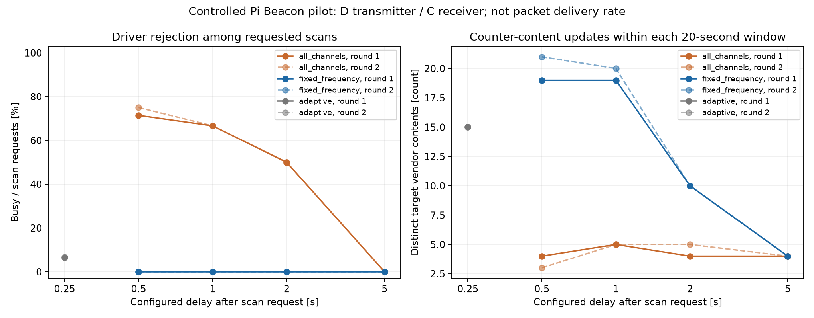

# Week29：Piスキャンbusyの比較試験（2026-11-19）

## 今回分かったこと

**このC/D構成では、全チャネルスキャンが約3.5秒続く間に次の要求を出す条件でbusyが増えた。既知周波数のみ・0.5秒間隔は2巡ともbusy 0件で、1秒ごとの研究用カウンタ更新を各20秒窓で19／21種類取得した。**

権限拒否・timeoutは全20区間で0件。今回のbusyはOS権限拒否と区別できた。NetworkManager等の要求主体を完全分離した実験ではないため、すべてのbusyの原因を単一に断定しない。試験後の通常収録復帰を確認済み。

## 実施条件

- Dを一時送信機、Cを受信機とした実RF試験。実ドローンは使用していない。
- 両台の保存済みホスト鍵・node_id・release・RAM／SD余力を確認。元の設定・旧ログを保持し、B/E/Fには操作していない。
- 管理接続はCが5GHz、Dが2.4GHz。接続先やチャネルは変更せず、Dの既存チャネルに一時APを追加した。機種・配置・距離を統制した端末間比較ではない。
- 送信は別の`PI-RID-SCAN-*`研究用セッションID、ローカル管理MAC。Vendor IEのカウンタを約1秒ごとに更新した。Locationは送らず、偽のGPS／高度を作っていない。
- 受信はLinuxのスキャンキャッシュAPI。キャッシュを0.25秒待ちで巡回し、要求間隔0.5／1／2／5秒、全チャネル／既知周波数のみを比較。現行の適応モード0.25秒も評価した。
- 各条件20秒×2巡。seed=20261119で並べた1巡目を2巡目で逆順にし、区間間に2秒待ちを入れた。前後に要求なしの20秒対照を追加し、全20区間を完了。
- 通常receiverは両台とも試験中だけ停止。実験ファイルは別ディレクトリに分離し、15分後の自動復帰タイマーと試験プロセスの実行上限を先に設定した。

## 結果

以下は2区間合計の要求・busy。内容種類は各20秒窓で取得した、研究用カウンタ込みVendor IEの種類数であり、位置更新数・物理パケット数ではない。

| 方法 | 要求後の設定待ち時間 | busy／要求 | 内容種類（1巡目／2巡目） | worker子プロセスのピークRSS最大 |
|---|---:|---:|---:|---:|
| 適応（全域探索＋学習周波数） | 0.25秒 | 6/90（6.7%） | 15／15 | 22.9MiB |
| 全チャネル | 0.5秒 | 19/26（73.1%） | 4／3 | 23.1MiB |
| 全チャネル | 1秒 | 20/30（66.7%） | 5／5 | 23.2MiB |
| 全チャネル | 2秒 | 10/20（50.0%） | 4／5 | 22.9MiB |
| 全チャネル | 5秒 | 0/8（0.0%） | 4／4 | 22.9MiB |
| 既知周波数のみ | 0.5秒 | 0/79（0.0%） | 19／21 | 22.6MiB |
| 既知周波数のみ | 1秒 | 0/40（0.0%） | 19／20 | 23.1MiB |
| 既知周波数のみ | 2秒 | 0/20（0.0%） | 10／10 | 23.1MiB |
| 既知周波数のみ | 5秒 | 0/8（0.0%） | 4／4 | 22.8MiB |

全区間はduration_completeで終了した。要求なしの対照2区間では、試験開始後の新しい対象キャッシュ時刻は0件だった。この2窓だけでNetworkManager等の自動スキャンが常に存在しないとは言えない。



横軸は要求コマンド終了後の設定待ち時間（対数軸）。失敗時は既存の1／2／4秒等のバックオフも働くため、厳密な実要求周期ではない。左の分母は実際に出したscan要求数。右は20秒窓ごとのVendor内容種類で、送信総数を分母とするPDRではない。実線と破線は独立飛行ではなく、同じ1組で順序を反転した2巡。

## スキャン時間との関係

`iw event -t`で開始・終了を対応付けた266組を得た。曖昧な対応や時刻逆行は集計から保留して件数を記録する実装とした。今回の未閉鎖開始は0件。

全チャネル条件の窓内通知間隔中央値は各窓で約3.53〜3.61秒、既知周波数のみは約0.047〜0.049秒。全域スキャンが終わる前に0.5〜2秒で要求を重ねることと、busyの増加は整合する。5秒設定ではbusyは0だが、20秒の内容取得は4種類へ減った。

対応は同じCのUTC runラベルと通知時刻による窓内集計。境界をまたぐスキャンは時間集計から外し、ハードウェア時刻精度や個々の要求主体の識別を保証しない。

## 運用への判断

1. **対象の周波数が確認できている短期実験**では、既知周波数＋0.5秒を候補設定とする。今回の2窓ではbusy 0で、1秒設定以上の内容種類を取得した。
2. **未知のドローンや別チャネルも探す通常収録**を、固定周波数へ自動変更しない。現行の適応方式は探索範囲を維持し、この試験ではbusy 6/90＝6.7%・内容各15種類だった。
3. 既存コードでは周波数をまだ学習できない場合、全域探索へ戻る。対象RID待ちでbusyが多かった既往結果と整合するが、今回「送信なし×全設定」の対照実験までは行っていない。

したがって、**busy 0だけを目的に要求を遅くすればよい、という結論ではない**。未知対象の発見、内容鮮度、要求回数、資源余力を分けて扱う。通常起動の設定・受信周波数・NetworkManager・sudoers・本番パーサは変更していない。

## 復帰処理の失敗と修正

20区間の測定と一時送信停止は完了したが、最初の後処理は終了済みtransient unitの`stop`が「not loaded」で失敗し、通常収録を開始する行へ到達しなかった。初回[復帰結果](results/scan-busy-20261118T160046Z/restoration.json)を保持した。

一時AP消去・試験サービス非稼働を確認して通常receiverを起動し、C/D両方のactive・現在bootの新セッション・元の設定ハッシュ一致を確認した。[最終復帰結果](results/scan-busy-20261118T160046Z/restoration-final.json)。その後、予備タイマーを解除した。

`restore_scan_receiver.py`を追加し、LoadStateがnot-foundの場合と、本当に停止に失敗して試験が残っている場合を分離した。unloadの競合も再照合し、任意のエラーを無視しない。合成テスト3件と、C/D両方の実際にunload済みunitを使った再実行に成功した。[修正版の実機確認](results/scan-busy-20261118T160046Z/restore-fix-validation.json)。既存の通常receiverがactiveならstartは再起動を伴わない。

試験直後の通常収録に、既に停止した研究用IDのキャッシュが残る可能性がある。原記録は削除せず、私的な研究用IDの記録で実機RID解析から除外できるようにする。

## 成果物・再現

[全区間CSV](results/scan-busy-20261118T160046Z/results.csv)／[実行summary](results/scan-busy-20261118T160046Z/summary.json)／[集計](results/scan-busy-20261118T160046Z/analysis.json)／[スキャン時間・RSS・保存量CSV](results/scan-busy-20261118T160046Z/scan-duration-and-resources.csv)。生の観測・イベント・送信・局情報・設定・アーカイブはignored capturesの0700/0600へ保持し、Gitへ入れない。

バッチ本体は`week29/scripts/run_scan_busy_batch.py`。rootではなく、既存receiverと同じobserverユーザー＋範囲を限定したCAP_NET_ADMINで実行する。既存releaseは書き換えず、既存のrun_observerを起動する。通常収録が動いていれば二重起動を拒否する。

```sh
# 事前に通常収録の停止・復帰タイマー・有限時間の研究用送信を用意する。
# 以下の変数は私的な実機構成から設定し、実IDや接続情報を公開しない。
python3 week29/scripts/run_scan_busy_batch.py \
  --release "$RELEASE" --config "$NODE_CONFIG" \
  --output "$NEW_PRIVATE_OUTPUT" --target "$PRIVATE_STUDY_MARKER" \
  --frequency "$CONFIRMED_STUDY_FREQUENCY" --duration 20

python3 week29/scripts/analyze_scan_busy_artifacts.py \
  --private-root "$PRIVATE_COLLECTION" --results "$ANONYMOUS_RESULTS"
python3 week29/scripts/plot_scan_busy_results.py --results "$ANONYMOUS_RESULTS"
WEEK29_REQUIRE_REFERENCE=1 python3 -m unittest discover -s week29/tests -v
```

アーカイブ解析は展開せず、リンク等を拒否して必要なファイルだけを読む。送信停止・一時AP消去を確認してから通常収録を戻す。復帰用root helperは研究用unit名と固定receiverサービスだけを操作し、チャネルや設定を変えない。

この試験は1組・各20秒のpilotである。別機種・別チャネル・移動・遮蔽・長時間・実ドローンの性能には一般化しない。実ドローン評価は後日Issue #99、現在の追跡先は #97。

## コード検証

新規8テストを含むWeek29全81件、UAV50件、Go、contracts21件が成功。図は画像化して軸ラベルの重なりを修正し、最終版を目視確認した。生データを含まない公開境界検査も実施する。試験の20区間と復帰修正の実機確認を、合成単体テストの成功とは分けて記録した。
