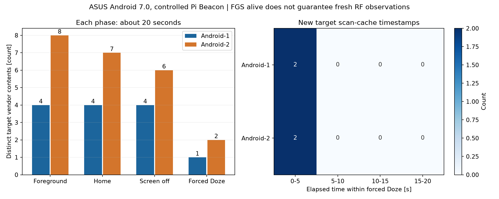
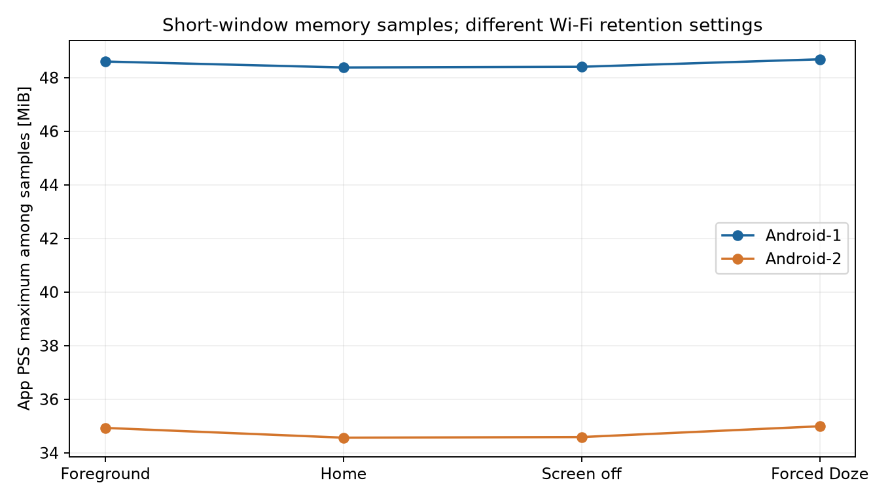

# Week29：Android 2台のバックグラウンド収録試験（2026-11-19）

## 結果

**接続されていたAndroid 2台で、画面表示→ホーム→消灯→強制Dozeを各20秒実行した。両台とも消灯中に研究用Remote IDとRSSIを保存した。一方、強制Dozeでは新規対象観測が最初の5秒に偏り、残り15秒は0件だった。**

Foreground Serviceは全フェーズの監視サンプルで継続していた。これを、Doze中に新しい電波を継続取得できた証拠とは扱わない。端末自己位置も別評価で、Android-1はnetwork由来の新規測位が各フェーズ1件、Android-2は0件。今回GNSSのGPS取得成功・1Hz測位は確認できていない。

## 端末と設定

- 両台：ASUS_Z017DA、Android 7.0/API24。Pixelは今回接続されていないため試験していない。
- Android-1はv0.14、Android-2はv0.13だった。両台の既存DB・設定を先に私的アーカイブへ保全し、Android-2だけ既存データを保持する上書き更新でv0.14へ揃えた。アンインストール・データ消去はしていない。
- 実効の位置情報権限は許可済み。アプリの保存設定はスキャン要求1秒・fastest=falseを維持した。権限をADBで追加付与せず、OSのスキャン制限も変更していない。
- Android-1は未知Wi-Fiも保存、Android-2は未知Wi-Fiを保存しない設定だった。設定を勝手に揃えず記録したため、総保存行数・PSS・端末間性能の公平比較には使わない。
- Dの一時Pi Beaconを使用し、別の研究用セッションID、カウンタ約1秒更新、Locationなしで送信。実ドローンは使用していない。PiとAndroidの同一設置位置・距離や電力校正を保証する試験ではない。

## 手順と測定した量

1. ADB接続・起動・モデル/API・アプリ版・権限・非PINロック・既存サービス停止を確認。
2. 旧DB/設定を保全し、必要な端末だけ上書き更新。
3. Dの一時送信を確認し、各端末を順にUIから受信・記録開始。
4. 画面表示、ホーム、消灯、強制Dozeを各20秒。サービス・画面・deep idle状態、PSSを巡回記録。
5. 強制Dozeでは電池サービスをunplugとして模擬し、deep idleのmState=IDLEを実際に確認。USBは物理接続したままで、自然Doze・実放電試験ではない。
6. unforceとbattery reset、UIで記録/受信停止、DB保全、アプリ再起動後の記録保持を確認。
7. Dの送信停止・一時AP消去・通常receiverのactive/新セッション/設定保持を確認し、予備復帰タイマーを解除。

観測の区間割当ては端末内monotonic時刻と/proc/uptimeで行い、境界の100msを除いた。受信した全Wi-Fi、対象研究用ID、キャッシュ鮮度、内容種類、自己位置、独立保存測位を区別した。独立した真位置や物理的同一パケットは確認していない。

## フェーズ別結果

| 端末 | 段階 | 対象IDのfresh保存行 | 対象Vendor内容種類 | 新規の独立保存測位 | PSS最大（巡回サンプル） |
|---|---|---:|---:|---:|---:|
| Android-1 | 画面表示 | 11 | 4 | 1 | 48.6MiB |
| Android-1 | ホーム | 12 | 4 | 1 | 48.4MiB |
| Android-1 | 消灯 | 12 | 4 | 1 | 48.4MiB |
| Android-1 | 強制Doze | 2 | 1 | 1 | 48.7MiB |
| Android-2 | 画面表示 | 8 | 8 | 0 | 34.9MiB |
| Android-2 | ホーム | 8 | 7 | 0 | 34.6MiB |
| Android-2 | 消灯 | 6 | 6 | 0 | 34.6MiB |
| Android-2 | 強制Doze | 2 | 2 | 0 | 35.0MiB |

全対象行にRSSI値があった。fresh行はAPIの鮮度フラグであって、独立した物理送信数ではない。Vendor内容はカウンタ込みであり位置更新数ではない。各フェーズに最低4サンプルあり、全てFGS=trueだった。



左：各約20秒窓の異なる対象Vendor内容数。右：強制Dozeの5秒刻みの新しい対象キャッシュ時刻数。両台とも[2,0,0,0]となり、開始直後の記録だけでDoze全区間の取得継続を主張できない。端末・OS一般の検出率・PDRではない。



PSSはアプリプロセスの共有ページを按分したメモリ指標で、RSS・Javaヒープ上限とは別。全Wi-Fi保存設定が異なるため、この図から端末の優劣を決めない。CPU負荷、自然放電、4時間連続運用は今回測定していない。

## DB保持・自己位置・解析修正

Android-1は新規3,081行、Android-2は29行を保存した。一般Wi-Fiを保存する設定の違いを含む値で、対象機体の送信数や受信性能ではない。更新前アーカイブと試験前snapshotの照合でも、両台の旧観測・独立保存測位に欠落/変更0件を確認した。[更新前データ保持](results/android-background-20261119T003039Z/pre-update-preservation.json)。両台でSQLite integrity_check=ok、試験前の観測行・独立保存測位の保持、アプリ再起動後の観測全行保持を確認した。

AndroidのIDは`rid_messages[].uas_id`、Pi側の一部解析形式は`claimed_uas_ids`であり、初回集計は後者だけを見て対象0件となった。元のsnapshot・初回validationを保持し、両形式を扱うhelperとテストを追加して同じDBから再集計した。本番parserの受理条件を緩めたり、取得データを書き換えたりしていない。

Android-1の新規測位はnetwork由来で、GNSS/真位置精度の証明ではない。観測への位置添付MATCHEDは表示時90行・ホーム122行、消灯/Dozeは0行。Android-2は新規測位0件。Wi-Fiの受信成功と位置が付くことを分離して記録する。

## 後処理・未実行

両台とも受信停止、強制idle解除、電池サービス模擬状態解除、位置権限保持を読み戻しで確認。初期が画面ONだったため、終了後も画面ONへ戻した。Dも通常収録に復帰し、設定は保持。Cの既存収録は停止していないので研究用IDが残る可能性があり、私的な研究用ID記録で実機ドローン解析から除外する。

heading_matched_recordsはスマホ方位の時刻対応であり、電波到来角/AoAの測定ではない。

この試験で確認できたのは、今回の端末/設定/短時間条件の結果。自然Doze、別OS、Pixel、再起動後自動復帰、非充電実放電、GPSの独立真値、長時間、実ドローン受信は未実行。新しい実ドローン試験は後日#99に分離したまま。

## 成果物・再現

[匿名summary](results/android-background-20261119T003039Z/summary.json)／[フェーズCSV](results/android-background-20261119T003039Z/phases.csv)／[端末とPiの後処理確認](results/android-background-20261119T003039Z/cleanup.json)。個人の位置・ID・端末serial・DB・原ログ・設定はignored captures配下0700/0600だけに保持。

実装：`experiments/kmp-rid-observer/scripts/smoke_device_persistence.py`に任意の`--include-forced-doze`と`--target-id-file`を追加。`background_evidence.py`でAndroid/PiのID形式とdeep idleを区別。`week29/scripts/summarize_android_background.py`で私的snapshotから再集計し、`plot_android_background.py`で匿名図を生成する。

```sh
# 研究用の有限時間Pi送信を別途起動し、許可済み・非PINロック端末を選ぶ。
python3 experiments/kmp-rid-observer/scripts/smoke_device_persistence.py \
  --serial "$AUTHORIZED_DEVICE" --output "$NEW_PRIVATE_OUTPUT" \
  --phase-seconds 20 --source-kind controlled --include-forced-doze \
  --target-id-file "$PRIVATE_STUDY_MARKER"

python3 week29/scripts/summarize_android_background.py \
  --private-input "$PRIVATE_STUDY_ROOT" --output "$NEW_ANONYMOUS_RESULTS"
python3 week29/scripts/plot_android_background.py --results "$NEW_ANONYMOUS_RESULTS"
python3 -m unittest discover -s experiments/kmp-rid-observer/tests -v
```

入力設定、保全アーカイブ、チェックサム、run情報は非公開。snapshotは読み取り専用で解析し、解析前後のSHA-256一致を確認した。今回のMDを含む全経緯は[Week29総覧](00_Week29の実施内容と残件総覧.md)から参照できる。

## テスト

Android補助Pythonは新規6件を含む25件、Week29は81件、UAVは50件、Go、contracts21件が成功。新規テストはID形式差・一般Wi-Fiと対象IDの分離・鮮度不明/重複・light/deep idle・区間境界・独立保存測位のsnapshot保持を検証した。実端末2台の8フェーズ実施と、これらの合成テストの成功は別の証拠として扱う。
