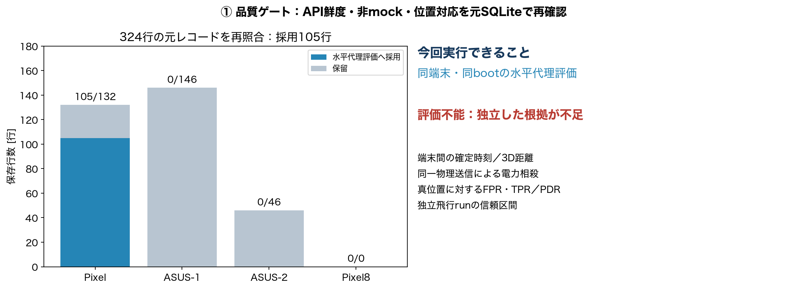

# Issue89：元観測照合と評価可能範囲の確定

2026-11-19。11月16日の保存済み対象データを再監査した。後日のPi/Android室内試験は混ぜていない。新規実ドローン実験・位置真値の取得ではない。

## 今回確定したこと

既存CSVだけを信頼するのではなく、元SQLite 4件、独立保存の自己位置、参照デコード結果へ戻り、324行すべてを照合した。既存の105行の採用マスクは変更せず、同じ結果になることを確認した。

| 匿名端末 | 対象保存行 | 元観測へ対応 | 鮮度・非mock条件通過 | 採用 | 保留 |
|---|---:|---:|---:|---:|---:|
| Pixel（6 Pro） | 132 | 132 | 132 | 105 | 27 |
| ASUS-1 | 146 | 146 | 146 | 0 | 146 |
| ASUS-2 | 46 | 46 | 46 | 0 | 46 |
| Pixel 8 | 0 | 0 | 0 | 0 | 0 |
| 計 | 324 | 324 | 324 | 105 | 219 |

`cache_stale=false`と`mock=false`は保存されたAPI情報であり、物理的に別パケットであること・GPS真値・ハードウェア真正性を保証しない。Pixel 8の対象0行はGPS不良・受信率0%を意味しない。

照合した項目は、端末別名＋boot＋観測monotonic時刻による一意対応、RSSI、スマホ位置、参照デコードの申告位置、そこから再計算した水平距離、別保存fixとの一致、鮮度・mock・観測から配信までの時刻整合。元観測が曖昧、CSV値不一致、元DBのハッシュ不一致、旧マスクとの採否不一致なら後段へ進まない。

採用条件は従来の探索的条件を維持した。同boot、位置対応、時刻差絶対値2秒以内、OS水平精度申告20m以下、精度申告／申告水平距離0.25以下等。219行の保留理由は最後の比率条件。これは真の測位誤差が25%以下という証明ではない。

## 実行できる評価と、できない評価



| 用途 | 今回の判断 | 不足している根拠 |
|---|---|---|
| 同端末・同bootの水平モデル代理評価 | 条件付きで実行可能 | 真位置ではなく申告位置を基準にする |
| 端末間の確定暦時刻対応 | NOT_EVALUABLE | 提供済み証拠の独立暦時刻アンカー0件 |
| 3D斜距離・高度偽装評価 | NOT_EVALUABLE | 共通高さ基準の独立台帳なし |
| 同一物理送信のDRSS・共通電力除去 | NOT_EVALUABLE | #95の確認済み同一物理送信0件 |
| 真位置に対するFPR/TPR | NOT_EVALUABLE | 独立真位置・正常／攻撃ラベルなし |
| PDR | NOT_EVALUABLE | 実送信パケット総数なし |
| 独立飛行runの信頼区間 | NOT_EVALUABLE | 独立runラベル未確立 |

「情報がないまま実行待ち」にせず、**現在の凍結データでは評価不能**と機械可読表へ確定した。新しい独立証拠が得られれば別ポリシーで再評価する。提供済み資料以外にも根拠が絶対存在しないと証明したものではない。

全324行の絶対電力校正フラグにtrueはなかった。参照デコードにはheight_type=0があるが、スマホ高度・RID Geo高度・Heightが独立に共通基準へ校正された証拠にはならない。候補時計補正を確定同期へ、申告位置を実際の機体位置へ昇格させない。

## 成果物・再現

- [品質監査JSON](results/research-review-20261119-f/quality-gates.json)、[用途別ゲートCSV](results/research-review-20261119-f/capabilities.csv)
- [段階実行記録](results/research-review-20261119-f/execution.json)：#89→#96→#93の順序、コードhash、終了状態
- 非公開：`captures/week29/research-review-20261119-f/row-gates-private.json`、入力hash群、元DB/参照JSONL/位置CSV。0700/0600。

```sh
python3 week29/scripts/run_field_review.py \
  --evidence-config captures/week29/research-input-private.json \
  --raw-config captures/week29/research-raw-input-private.json \
  --selection-manifest captures/week29/issue89-quality-manifest-a/selection-private.json \
  --baseline-summary week29/results/issue89-manifest-attacks-a/summary.json \
  --private-output captures/week29/NEW_PRIVATE_RUN \
  --output week29/results/NEW_PUBLIC_RUN
```

描画にはNumPy/Matplotlib等の既存研究環境を用いる。今回は既存Mac venvで実行。出力先は必ず新規名。入力の原本・作業コピー・下流終了時のhash一致を確認し、元データ・旧マスク・過去結果を上書きしていない。

後段の[モデル診断36](36_Issue96_固定モデルの失敗診断と採用条件の感度.md)、[図と個票説明37](37_Issue93_採否と警報の説明図と非公開ビューア.md)へ同じ105行を引き渡した。Issue全体や将来データの品質まで完了認定するものではない。新規実ドローンは後日#99。
