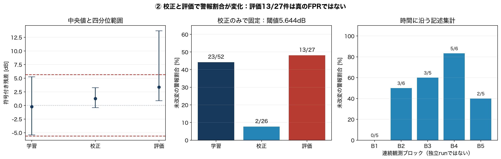
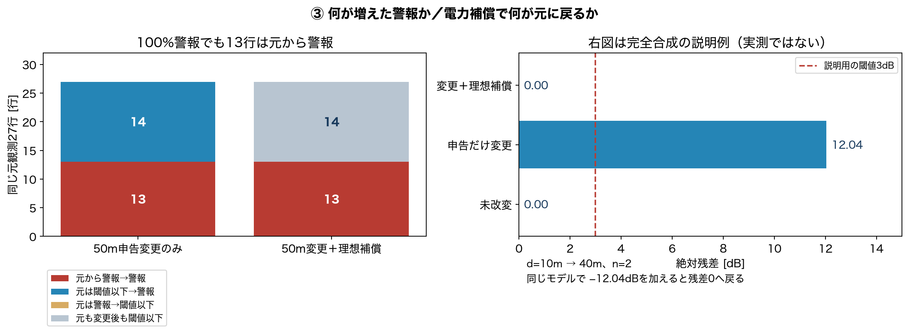
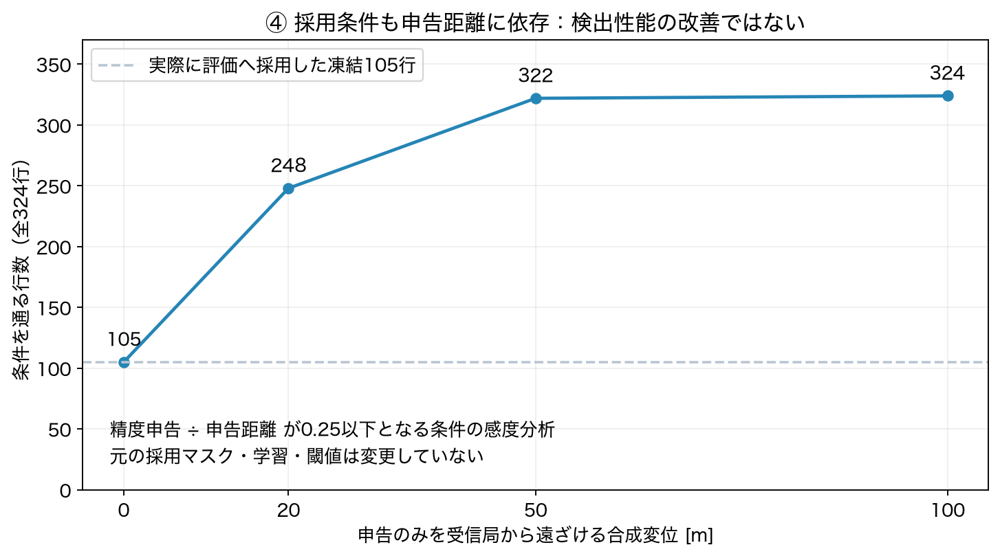

# Issue96：固定モデルの失敗診断と採用条件の感度

2026-11-19。#89で再照合した既存105行を使い、以前の結果を改善せずに失敗を説明した。RSSIと申告位置・スマホ位置は保存実測、位置変更・dB加算は合成。RF電力操作・独立真位置に対する攻撃検出率ではない。

## 結果：閾値を固定しても警報割合が移行しない

学習52／校正26／評価27行、境界10秒除外、同boot・時間順分割を維持。学習から求めた水平代理モデル `f(d)=a−10n_h log10(d)` は `a=−30.1750dBm, n_h=3.11083`。閾値は校正区間の絶対残差95分位 `5.64358dB`。既存の係数・閾値・13/27警報と一致しなければ停止する。評価を見て再調整していない。

| 区間 | n | 未改変の警報 | 割合 | 符号付き残差中央値 | 学習距離域外の行 |
|---|---:|---:|---:|---:|---:|
| 学習 | 52 | 23 | 44.23% | −0.235dB | 0 |
| 校正 | 26 | 2 | 7.69% | 1.267dB | 20 |
| 評価 | 27 | 13 | 48.15% | 3.349dB | 4 |

校正区間の残差の四分位範囲は学習・評価より狭かった。経験的95分位は、小標本26行で実FPRを5%へ保証するものではない。評価区間の学習距離域外は4行だけなので、13警報のうち**少なくとも9行は学習距離域内**で発生しており、外挿だけでは説明できない。

これは分布変化・校正の代表性不足と整合する結果。送信電力、遮蔽、姿勢、マルチパス、高度無視、位置誤差のどれが物理原因かは、この記録から特定していない。`n_h`も真の伝搬指数・送信電力を同定した値ではない。

評価27行を30秒の時刻区分から順番にまとめ、小さい区分を隣接へ統合した5以上の行数の記述ブロックは `0/5, 3/6, 3/5, 5/6, 2/5`。合計13/27と一致する。これらは独立飛行runでも独立試行でもなく、IID信頼区間や有意差を出していない。

## 100%警報の中身を分ける

50m遠方の申告変更で27/27警報となるが、13行は元から警報、残り14行が閾値以下から警報へ変わった。変更後は27行すべてが学習距離域外になる。100%という数字を実機検知成功率としない。

同じモデルの上限なし補償 `ΔP=−10n_h log10(d'/d)` を実測RSSIへ合成加算すると、符号付き残差の最大差は約 `1.42×10^-14dB`。元の13警報は13警報のまま、残る14行も閾値以下のままだった。正常に戻せた・真位置を確認したという意味ではなく、モデルスコアが元と同じになる反例。

右側は完全合成の説明例で、実測行ではない。スコアが小さいとは「固定したモデルとの整合」であり、「真位置に近い」という意味ではない。上限なしの理想補償には攻撃者のモデル知識と任意電力を仮定している。実際の出力範囲、飽和、受信欠落までは再現していない。±1/3/6/10dB等を含む従来の81条件は維持し、[対比較CSV](results/research-review-20261119-f/paired-transitions.csv)へ分母・保留・外挿・警報遷移を出した。近方で受信局を越える条件は全保留であり、検知率0%ではない。

## 新しく確認した点：採用条件も申告値に依存する

元の探索用条件は `OS精度申告 / 申告水平距離 ≤ 0.25` を含む。同じ観測のまま申告だけを遠くすると、この比率は小さくなる。

| 合成的な遠方申告変更 | 条件を通る行（全324行） | 元の105行以外から新しく通る行 |
|---|---:|---:|
| なし | 105 | 0 |
| 20m | 248 | 143 |
| 50m | 322 | 217 |
| 100m | 324 | 219 |

これは品質フィルタの感度分析であり、受信率・測位精度・検出率の改善ではない。変更後の行を学習や評価へ追加せず、凍結105行は保持した。探索用の比率を、攻撃者に左右されない信頼性判定や位置認証へ転用する根拠はない。

## GhostBusterとの対応と研究判断

[GhostBuster原著（Keizerほか、CCNC 2024）](https://pure.tue.nl/ws/files/343585890/GhostBuster_Detecting_Misbehaving_Remote_ID-Enabled_Drones.pdf)のIV-Aは受信局間の同期・協調を仮定しないと明記する。したがって「非同期だから先行研究にない」とは言えない。V節は伝搬モデルによる距離推定と位置評価、VI-Dは送信電力操作も議論する。原著が電力操作を無視したという説明も不適切。

今回の差分は、送信ごとに自由な未知電力・1送信1RSSIという厳格条件、観測者の実データ品質、校正・真値の不足。原著の電力操作の議論を、この条件やすべての幾何配置への無条件保証としては扱わない。これは今回の識別可能性と入力ゲートからの判断であり、原著の性能を再現したとの主張ではない。

研究上の採否（ADR）を次のように固定する。

| 対象 | 判断 | 次に必要な根拠 |
|---|---|---|
| 今回の単局水平モデル | 検出器への採用を支持しない | 独立run・正常真値で警報制御を評価 |
| 申告距離を含む品質比率 | 探索的選別のみ | 申告値に依存しない品質条件を設計し、別データで検証 |
| 非同期・別送信・任意電力・1RSSI | 一般の位置識別は保証不可 | 電力制約・独立真値・追加観測等を明示 |
| 同一送信の多局RSS差 | 条件付き追加方式 | #95の物理送信対応、配置、局間偏差・伝搬の校正。特別な配置の識別不能例も除外しない |
| 局所複数方向RSSI | 別の追加観測方式 | 同一送信の複数方向計測と利得校正。単一スマホRSSI・端末方位と混同しない |
| ZKPへの接続 | 現モデルを位置真実性の証明にしない | 証明対象と入力品質・保証外を先に確定 |

別の距離・電力の組合せが同じRSSIを作る数理反例と、固定した実測RSSIへ補償dBを加える代理実験では、変更する変数が違う。両者の補償の符号や分母を混同しない。ZKPや台帳は入力の物理真実性を作らない。

## 関連PRの監査

[監査JSON](results/research-review-20261119-f/pr-audit.json)ではGitHubの状態・head SHAと、各headのREADME/研究報告を確認した。OPENは「未実装」の意味ではなく、以下の以前の実行を今回再実行した意味でもない。

| PR | 今回確認した位置づけ | 状態 |
|---|---|---|
| #71/#72 | PHY環境・正常/申告変更、パケット単位電力反映の段階的成果 | OPEN、別branchの成果を保持 |
| #73 | 別送信1RSSIと同一送信多局を区別する監査 | OPEN |
| #74/#76 | 正常校正・20seed、攻撃者の受信局知識・電力制約の合成評価 | OPEN、今回RF再実行なし |
| #78/#79 | 配置/方向条件、GhostBuster式の独立実装と数値評価 | OPEN、現在checkoutには選択反映された計算関数/テストあり |
| #80 | Dataset-21の実ファイル監査・5局対応ゲート | OPEN、選択反映あり |
| #81/#82 | Dataset-21アダプタとmainへの反映 | MERGED。座標等が未確認の実測性能はNOT_RUNのまま |

Dataset-21のRT調整値を独立した絶対電力校正とせず、近接時刻を同一送信IDに置換しない。今回、未提供の受信局座標や実機真値を作って評価を進めていない。新規実ドローンは#99。

## 再現・成果物

[診断JSON](results/research-review-20261119-f/model-diagnosis.json)、[記述ブロックCSV](results/research-review-20261119-f/descriptive-blocks.csv)、[採用条件の感度CSV](results/research-review-20261119-f/claim-dependent-selection.csv)。再現は[35の有限時間パイプライン](35_Issue89_元観測照合と評価可能範囲の確定.md)。個票・モデル入力・実座標・申告IDは非公開。
