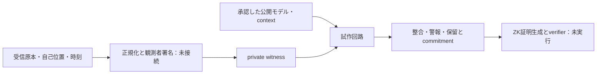

# 回路設計 v0：何を非公開にして、何を検査するか

これは当初の`Circuit`の仕様。追加の2D/3D・位置/高度/時刻誤差を扱う別statementは[誤差対応の設計と実行結果](uncertainty/README.md)を参照。

## 1. 研究上の位置づけ

現在の研究の主題は「未知送信電力下のRSSIで位置申告の不整合を検査できる観測条件」である。ZKPは、成立した検査を非公開入力で再計算できるようにする後段であり、RSSIの識別不能性を解決する手段ではない。

既存`circuits/remoteid_consistency_rel.circom`は回路外の`measured_range_cm`と申告距離を比較する。`circuits/uav_witness_attestation_v2.circom`はその測距・profile等を観測者署名へ束縛する既存系である。未知電力下でRSSI由来距離の正当性が未確立なため、今回の案は実測RSSIそのものと固定方針を入力にする。既存V2を置換せず、観測専用Version 0対応を証明入力の無条件受理に流用しない。

## 2. 対象statement

「この公開context・方針・commitmentに対応する非公開観測が存在し、指定された距離帯のRSSI区間と品質条件から、この公開statusが得られる」。

これは**計算核**のstatement。公開commitmentが事前に正当な観測者の署名済み記録へ結合されない限り、proverが都合のよい入力とcommitmentを自作できる。現試作だけを観測証明として受理してはいけない。

## 3. 入出力

| 公開入力 | 意味・外部で必要な確認 |
|---|---|
| Session / FrameID / ClaimToken | run、局所座標系、RID申告を参照するopaque token。任意field要素を許す現回路だけでは実在・一意性・認証を保証しない |
| Claim[3] | 申告位置の局所ENU座標に固定offsetを加えたcm整数。元RIDとの対応は外部確認 |
| ClaimTime | セッションepochからの秒。RIDの毎時周回値を直接入れない |
| Bounds[5] | cm²の距離二乗帯の境界。左閉右開、全入力領域を覆う |
| Low[4], High[4] | 各帯のRSSI許容区間。shifted centi-dBm、両端を含む |
| MaxAge / MaxAccuracy | 観測時刻差の最大秒、自己位置精度指標の最大cm |
| PolicyDigest | 公開方針のMiMC hash。承認方針かどうかはverifier側allowlistで確認が必要 |
| Status | 0=モデル整合、1=モデル不整合、2=時刻/精度による保留 |
| Commitment | context・方針・claim・private観測・statusを束縛したsalt付きMiMC hash |

| private witness | 単位・制約 |
|---|---|
| Observer[3] | 同じ局所座標系・offsetのcm整数、各20bit |
| RSSI | `100 × RSSI[dBm] + 16000`、整数0〜16000（−160〜0dBm） |
| ObservedTime | 同じepochからの秒、32bit |
| Accuracy | 自己位置精度の外部指標、0〜65535cm。真の誤差そのものではない |
| Nonce | 非ゼロ128bit。実運用では暗号学的乱数。テストの定数nonceは合成専用 |

欠測・未知の位置/精度を0で補って証明しない。現v0のstatus=2は入力が存在する場合の時刻/精度保留のみ。欠測・API取得不能・未対応版はアダプタで`NOT_EVALUABLE`として回路実行を止める設計とする。そのアダプタは未実装。

## 4. 距離・RSSI判定

各座標は`0 ≤ x ≤ 2^20−1`。全ての座標に同じ既知offsetを加えるため、差分は不変。1軸約10.49kmの局所boxに限定し、広域や負座標をfield表現で逃がさない。

\[
 s=\sum_{j=1}^{3}(q_j-o_j)^2
\]

\[
 0=b_0<b_1<b_2<b_3<b_4=3(2^{20}-1)^2+1
\]

\[
 k:\ b_k\le s<b_{k+1},\qquad
 inside=[L_k\le r\le U_k]
\]

bin選択数を厳密に1へ拘束する。距離は平方根・logを使わない。二乗和は最大`3(2^20−1)^2 < 2^42`でBN254 scalar modulusより十分小さく、入力range制約と合わせてwraparoundを防ぐ。境界は42bit、RSSI端点は14bitに加えて16000以下へ制約する。幅0/順序逆転のbin、逆転RSSI区間を拒否する。

\[
 eligible=[|t_o-t_q|\le T]\land[a\le A]
\]

\[
 status=\begin{cases}2 & \neg eligible\\0&eligible\land inside\\1&eligible\land\neg inside\end{cases}
\]

時刻差は未来/過去を対称に扱う。実験で過去側のみ許す方針が必要なら、別の明示的policy版とテストを追加する。秒単位の量子化はsubsecond同一送信の証拠に使えない。

## 5. 束縛

BN254 field要素を32byte big-endianで扱うMiMC。Go native hashとin-circuit hashの対応をテストする。可変長文字列やJSONの直接hashではない。

- `H_policy = MiMC(3201001, MaxAge, MaxAccuracy, Bounds[0..4], Low[0], High[0], …, Low[3], High[3])`
- `C = MiMC(3201002, Session, FrameID, ClaimToken, H_policy, Claim[0..2], ClaimTime, Observer[0..2], RSSI, ObservedTime, Accuracy, Nonce, Status)`

公開方針の差し替え、session/座標/RSSI/status等の改変は、元commitmentを維持したままでは制約を通らない。一方、署名/外部固定がなければ新しいcommitmentを作れてしまう。署名は鍵所持の証拠であり、センサーの正直さを証明しない。

nonceは低エントロピー座標/RSSIへの辞書攻撃を難しくする目的だが、乱数性は回路で証明していない。MiMC付き回路をコンパイルしただけで暗号学的ZK証明を生成したとは言わない。公開claim/context/status、複数回の適応的な照会、binモデルは情報を漏らし得る。最終公開範囲・反復照会制限は未確定。

## 6. モデル・観測の信頼境界

- Low/Highは合成fixture。実測校正・独立run評価を経た承認profileではない。未知電力の自由度によって真位置と別位置が同じRSSIを作れる問題は残る。
- 固定/緩やか/毎送信自由の電力条件を混ぜない。単局非同期の任意電力条件では一般的な位置検証を主張しない。
- ENU変換、offset、原点、MSL/楕円体/気圧高度の統一は回路外。FrameIDだけでそれらが正しいとは証明されない。未統一なら3D評価を止める。
- ClaimTokenと原RID bytes、Version、message内容の対応、重複・epoch展開・キャッシュ鮮度は回路外。Version 0受信そのものは機体認証ではない。
- 集約、同一物理送信照合、DRSS、観測の網羅性、複数観測者の独立性、Sybil・replay対策は未実装。都合のよい観測だけの選別を現回路は防がない。
- 実測ではない位置・センサー・署名鍵・setup/proofを公開用fixtureへ流用しない。

## 7. 既存系との接続案（未実装）

1. #89の有効manifestと元ログから正規化記録を作り、欠測・時刻/高度基準未確認は停止する。
2. #96の実測評価で、距離帯モデルを採る根拠と閾値を凍結する。モデルを選んでから回路を最適化する。
3. 署名済み観測のcanonical表現とこのcommitmentの結合を設計する。既存V2署名は別のメッセージなので、そのまま本回路の署名とみなさない。新しいdomain/statement/VK版が必要。
4. verifier側でprofile・FrameID・session・claimed token・観測者資格と重複を検査し、回路内署名または外部検証の境界を否定テスト付きで確定する。
5. 単体proofの実生成/検証まで確認してから集約/再帰/チェーンを判断する。旧VK・旧proofを新回路で再利用しない。
