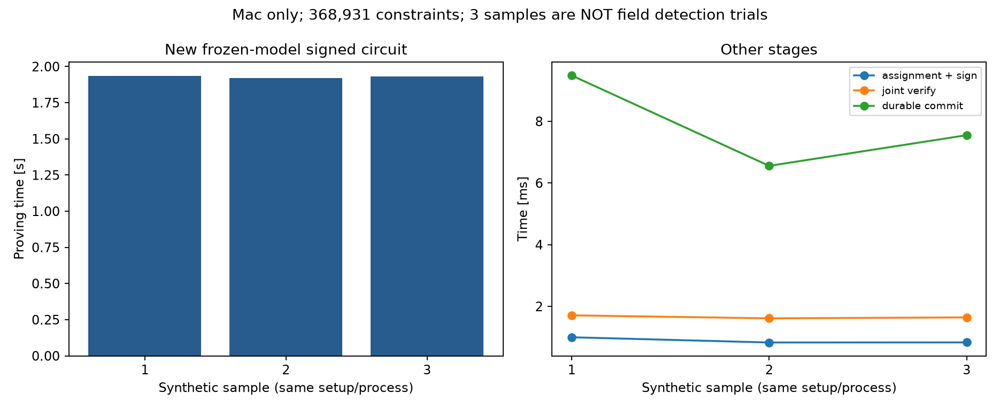

# #106〜#108：新モデルの署名接続・永続受付・公開評価

2026-11-25。研究PoCの実装と合成試験。**実機の位置偽装検知、真位置認定、センサー/機体/ハード認証を完成させた成果ではない。** 実測単局モデルの採用保留は#96、位置・時計・高度の根拠は#89に残す。

## 1. #106：新statementへの接続

`model_signed.go`に`SignedModelCircuit`を追加した。対象は凍結した未採用logモデル由来の8距離帯・内側/外側区間を使う`CalibratedCircuit`。旧合成4距離帯のproof/VKとは別statement。

- statement名：`frozen-log-2d-signed-v1-research-only`
- 新domain：3207001（全体policy）、3207002（観測nullifier）、3207003（署名message）。空間核の3206001/3206002は維持。
- 署名はcore commitmentとprofile、session/frame/claim、受信/claim時刻・時計誤差・既知フラグ、原本識別digest、record ID・期限・nullifierを結合する。
- `TimeKnown`/`HorizontalKnown`と時間差から空間核のEligibleを拘束する。未知品質を整合判定へ流さない。これは既知フラグ自体の真実性を証明するものではない。
- 公開鍵/署名Rの曲線・非単位元・部分群、scalar範囲を検査する。
- `VerifyModelProof`はこのstatementのpublic witnessをschema順にsnapshotし、そこから受付値を取る。別receipt JSONは受け取らない。
- profileは現在の凍結profileに限定。`AllowResearchProfile`が明示trueでなければ拒否する。未採用モデルを承認済み運用モデルへ昇格させない。

16ケースで署名/観測/品質/期限/原本digest/モデルの改変拒否を確認。既存の回路・受付・整数比較も回帰で維持。

### 正規化・原本と署名の仕様

原本IE/GPSからの処理は、既存のデコード・run品質監査→`geometry.py`のWGS84/ENU・外向きcm量子化→型付き整数のcore割当→観測者の確認と署名、という境界を固定する。

- キャッシュの受信時刻、boot/run、自己位置fixとの対応を保つ。export/poll時刻へ置き換えない。
- `CanonicalSource(run, boot, observedUS, rawIE)`は、Go `encoding/json.Marshal`による固定順配列 `['recorded-api-observation-v1',run,boot,observedUS,lowercase_hex(SHA256(rawIE))]`のSHA-256を128bit×2へ分割する。
- 署名はそのdigestと正規化後の全数値を共に結合する。受信済みrawIE/GPSからその数値を正しく抽出・変換したという判断は**署名側の責務**であり、回路内でrawバイトをSHA/復号/座標変換した結果ではない。
- 未確認のepoch/時計差・高度精度・高度基準を0や既知フラグで補わない。入力が構成できなければproof作成を止め、実行可能な未知品質statementだけを保留として扱う。
- 実機の署名API/秘密鍵保管、過去記録を観測時点で認証する仕組みは未実装。過去の実測記録へ今回の鍵で署名して「当時の認証」としていない。

## 2. #107：永続・原子的な受付

`receipt_store.go`にUnix向け`ReceiptStore`を追加。外部サービスやBC、追加DB依存を導入せず、**stableな別lock fileへのflock＋再読込み＋atomic rename＋fsync**でローカル保存する。

1. `VerifyAndStore`が新モデルのproof/contextを検証し、外部から作れない内部の検証済みtokenを得る。
2. proof検証はfile lockの外で実行する。
3. lock取得後に現在のledgerを読み直し、receipt keyとnullifierの両方の重複を確認する。
4. 0600の一時ファイルへ保存・fsyncし、rename後にdirectoryをfsyncする。保存完了前に成功応答をしない。

保存先はowner-onlyディレクトリ・ファイル。位置/RSSI・署名/proof・private witnessを保存せず、受理済みreceipt/nullifier/statementのhashだけを保存する。実データではignored capturesかGit外の私的領域を使う。

### 何を二重受理しないか

- receipt key：observer/session/RecordID。同じCでも別profileにして再利用を逃がさない。
- nullifier：`MiMC(3207002, observerKey.X, observerKey.Y, session, sourceDigestHi, sourceDigestLo)`。
- 同じ観測の新RecordID・新署名・新proofは、同じnullifierで拒否する。
- 対象は**宣言されたAPI観測記録**。同一物理RFパケットの確定ではない。run/boot/観測時刻/原本宣言を嘘に変えられる正規署名者まで防げるものではない。

SHA-256 checksumは破損検出であり、同じOSユーザーに書き換えられたledgerの真正性を保証しない。OS・保存領域と承認設定は信頼境界。TEE/TPM/DRIP実装ではない。

### 実行した保存試験

- 20並行goroutine、4並行プロセス：同一receiptの受理は1件。
- 別IDの同一nullifier：拒否。異なる正当fixtureは受理。
- プロセス再生成/ストア再open後の既受理拒否。
- rename前の書込み失敗と、別プロセスの強制終了：確定済みledgerを保持。残る`.pending-*`を自動昇格しない。
- 読取り専用、公開権限、symlink、破損、未知schema、10,000件の容量境界：失敗を成功にせず、原本を保持。
- 不正proof/未検証token：保存しない。

電源断の実機試験ではなく、Mac上のプロセス/ファイルシステム試験。rename後のdirectory fsync失敗では「durability uncertain」を返すため、呼出側は再読込み/同ID照合で結果を確認する。exactly-onceの応答配信や、同一OSユーザーによる攻撃への耐性は主張しない。未知schemaは拒否して保持し、自動の破壊的migrationをしない。

## 3. 実proof・署名・保存の統合試験

新statementをコンパイル・使い捨てsetupし、合成3件で署名→proof生成→public witness抽出→context/鍵/モデル/期限確認→proof検証→保存を実行した。

- 3件が受理され、再open後も3件を保持。
- 実proofの同時8要求では1件だけ受理。
- 同じ原本識別子を新IDで再署名し、新proofも実際に生成して、同一nullifierの重複として拒否。
- public statusの書換え、未来claim、期限切れ、research opt-inなしを拒否。
- 新statementは368,931制約。秘密鍵・setup鍵・proof・witnessはファイルへ出力しない。使い捨て単独setupはrelease鍵ではない。

[実行集計](results/issue106-108-20261125/model-e2e-summary.json)、[preflight](results/issue106-108-20261125/model-proof-preflight.json)、[ログ](results/issue106-108-20261125/model-proof.log)。旧モデルのproof結果からの推定ではない。

## 4. #108：性能と公開情報の評価

Mac/Go1.26.5、並列度2、Go soft GC target 1GiB。3件は**同一プロセス・同一setup**であり、独立実機runや検出精度の標本ではない。

| 工程 | 実行値 |
|---|---:|
| compile | 約0.915秒 |
| 使い捨てsetup | 約47.46秒 |
| 入力割当・署名 | 約0.83〜1.00ms |
| prove | 約1.919〜1.934秒 |
| 統合verify | 約1.61〜1.71ms |
| durable commit | 約6.56〜9.49ms |
| 入力〜保存（setup除外） | 約1.928〜1.946秒 |
| process全体のpeak RSS | 968,736,768 bytes ≒924MiB |
| Go heap in-use（終了時） | 295,976,960 bytes。peakとは別 |
| proofのシリアライズサイズ（数えたのみ） | 164bytes |
| public witness（数えたのみ） | 2,348bytes |
| 上記単純合計 | 2,512bytes。VK/registry/transport等は別 |

cold/warmの全環境を独立比較したベンチではない。初回proveと続く2回をCSVで分離し、キャッシュ効果・confidence intervalを3件から断定しない。Pi/Android、消費電力、長時間1Hz、field proofは未評価。



[CSV](results/issue106-108-20261125/model-benchmark.csv)、[記述統計](results/issue106-108-20261125/benchmark-statistics.json)。

### 何が公開されるか

schemaテストで、観測者位置/RSSI/誤差/観測時刻/時計誤差/既知フラグ/source digest/署名をprivateと確認した。秘密鍵はwitnessにも入らない。

一方、観測者公開鍵、claim点・claim時刻、profile、status、RecordID、期限、session、nullifierは公開。公開鍵による観測者の継続追跡、run内の同観測nullifier照合、公開statusからの絞込みは残る。匿名性・unlinkability・独立暗号監査の完了ではない。nonceの乱数性と公開照会の運用制限も回路外で、テストの固定nonceを実記録へ流用しない。

[公開/秘密フィールドの実検査](results/issue106-108-20261125/model-privacy-schema.json)。

## 5. 再現と公開範囲

```sh
cd week_tmp/circuit-design
mkdir -p results/NEW_RUN
GOMAXPROCS=2 GOMEMLIMIT=1GiB DRAFT_SUMMARY_PATH=results/NEW_RUN/constraint-summary.json \
  go test -count=1 -v ./...
go test -race -count=1 -run 'TestStore|TestSourceNullifier|TestFutureSkew|TestPublicExtraction|TestModelPrivacy' ./...
```

通常試験はsetup/proofを起動しない。資源を確認したうえで、明示的に新モデル統合試験を実行する。

```sh
GOMAXPROCS=2 GOMEMLIMIT=1GiB DRAFT_RUN_MODEL_PROOF=1 \
  DRAFT_SUMMARY_PATH=results/NEW_RUN/constraint-summary.json \
  go test -count=1 -timeout 240s -run '^TestModelEndToEnd$' -v ./...
```

ローカルpreflightは16GiB以上ではなく**12GiB以上のhost＋memory_pressure free 40%以上**という既定閾値を満たした場合のみ進めた。今回hostは16GiB。soft GC targetはOSのhard上限ではない。再帰setupや、別時点の資源余力を保証しない。

公開するのはコード・合成fixture・匿名集計・図・実行ログのみ。`scripts/check_publication.py`と目視で生capture、実座標、ID、鍵、setup/proof、DB、proof-cacheがないことを点検する。source digest/receipt storeの実値もpublic artifactに含めない。

公開用checkoutはmainから作成し、元の作業ブランチに残る他の未commit差分は持ち込んでいない。このため既存チェックは公開checkoutでUAV50件・contracts21件。元作業ブランチの98/48件をこのcheckoutの成功件数として流用していない。Go参照/回路・Python27+6件・保存raceも確認する。

## 6. 失敗・未実行

最初の保存試験はGo TempDirがowner-only条件を満たさず失敗した。fixtureに0700を明示し、公開権限の保存先を拒否する本体の制約は維持した。追加テストの編集で相対パスを一度誤り、正しいrepo rootから編集し直した。失敗を試験成功に数えていない。

未実行/残件：実機からの署名運用、独立真位置/正常runによる検知性能、実時計/高度精度、元IE/GPSの変換を回路内で証明すること、Pi/Android性能、匿名資格、EVM/再帰、正式なrelease setup。現在の単局モデルの採用保留は維持する。

この報告は#106/#107の限定PoCと#108の公開評価に対応する。機体認証システムや安全判定システムとしては公開しない。
