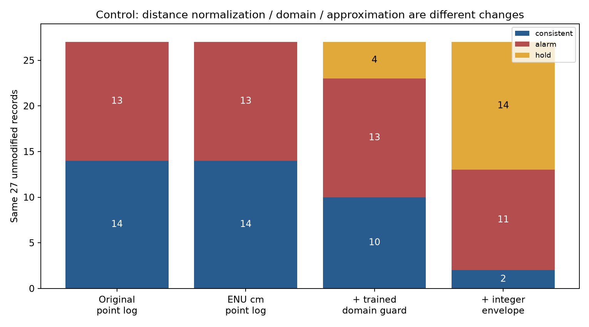
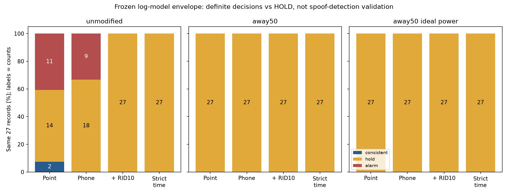

# 凍結した実測モデルと回路の接続・比較

2026-11-25。元の単局logモデルを**採用せず、比較対象として凍結したまま**、由来の明らかな整数近似を作り、同じ実測由来の評価27件を回路へ入力した。

## 結果

**計算の接続はできたが、位置偽装検知器としての採用は引き続き支持できない。** 原因を回路の問題と混同しないため、連続モデル・近似誤差・学習域外・位置/時刻の不確かさを分けた。

- 同じ27件×4位置/品質条件×3申告/電力条件＝324入力を、Python、Go参照実装、R1CSへ通した。**324/324一致**。
- 整合/警報と断定した結果と、同じ整数座標・距離範囲の連続log参照との食い違いは0件。**実機に対する誤警報0件という意味ではない**。
- 位置を点として扱った未改変27件でも、近似後は整合2・警報11・保留14。
- 50m遠方への合成変更は全件が学習距離域外。元の100%警報を検出成功として採用せず、今回の域外保護では全件保留。
- 時刻の対応が未確認な実データを厳格に扱う条件も全件保留。架空のclaim時刻を補完していない。

新しい回路は**空間判定の計算核**。署名付きZK証明・受付入口には未接続で、今回はsetup/proofを生成していない。

## 1. 比較したモデル

元の固定モデル：`f(d)=a−10n_h log10(d)`。

- a：−30.175003061704714dBm
- n_h：3.110833061353868
- 閾値：5.643584983424159dB
- 学習52・校正26・評価27。元の未改変13/27警報を変更していない。
- 係数・閾値・学習距離域は既存summaryから取得。今回の評価記録で再学習や再調整をしていない。

[固定モデル元集計](../../../week29/results/issue96-attacks-a/summary.json)、[生成profile](../profiles/frozen-log-envelope-2d-v1.json)。profileには元summaryのSHA-256を含む。距離約4.36〜38.20mの学習域から整数二乗距離域を定義し、その中を6区間、外側を未対応2区間とした。これは独立データで検証した「適用可能距離」の保証ではなく、外挿を断定へ使わないための保護である。

## 2. 近似で断定を変えないための内側・外側区間

回路では平方根・logを直接計算せず、8つの二乗距離区間に対する整数のRSSI範囲を使う。従来の任意合成4距離帯ではなく、上記の固定モデルから生成する。

区間`[s0,s1)`に対する単調減衰fと閾値τから、次を生成する。

- 外側区間：`[f(sqrt(s1)/100)−τ, f(sqrt(s0)/100)+τ]`
- 内側区間：`[f(sqrt(s0)/100)−τ, f(sqrt(s1)/100)+τ]`

RSSIは`100×dBm+16000`へ変換。外側は外向き、内側は内向きに丸め、さらに1centi-dBの数値余裕を置く。区間生成はDecimal精度80桁で行う。これは独立した形式的な数値誤差証明ではない。範囲内のRSSIを前提に区間をclipし、内側が空なら整合と断定しない。

位置誤差から得た可能距離範囲に重なる全区間を調べる。

1. 全ての内側区間にRSSIが入る → 整合。
2. どの外側区間にもRSSIが入らない → 警報。
3. それ以外、未対応距離域を含む、入力品質を確定できない → 保留。

[Python生成/連続参照](profile.py)、[Go参照/回路](../calibrated.go)。Goにも同じ生成済みprofileをembedし、Pythonとの一致を確認する。policy digestと観測commitmentには、旧回路と異なるdomain 3206001/3206002を使う。

## 3. 距離の定義を変える影響も分けて確認

元の距離は緯度経度からの水平距離。新回路は局所ENU座標をcm整数にして二乗距離を使うため、完全に同じ距離表現ではない。

同じ27件で距離正規化とRSSI量子化だけを変えた対照では、警報13/27のまま、警報ラベル変更は0件だった。距離の差の最大は約0.0368m。測位の真誤差を示す値ではなく、二つの距離定義・量子化の差である。

| 未改変の同じ27件 | 整合 | 警報 | 保留 |
|---|---:|---:|---:|
| 元の点logモデル・外挿あり | 14 | 13 | 0 |
| ENU cmへ変換・同じ点logモデル | 14 | 13 | 0 |
| ENU cm・連続参照・学習域外を保留 | 10 | 13 | 4 |
| ENU cm・整数区間近似・学習域外を保留 | 2 | 11 | 14 |

近似による追加保留は10件。うち元の警報2件を保留へ回しており、これを誤警報削減による精度改善とは評価しない。断定した13件は同じ距離定義/適用域の連続参照と一致した。



[正規化対照JSON](results/run-a/geometry-control.json)

## 4. 位置・申告変更・電力補償の条件

実測として維持したもの：保存済みRSSI、RID申告位置、同端末のGPS位置、時刻・精度の記録。元高度・時刻は私的個票へ保持するが、今回の2D空間核では高度/時計の正しさを証明しない。

合成/仮定：50mの遠方申告移動、元モデルに合わせたRSSIへのdB補償、各誤差半径と時間対応の条件。

| 位置/品質条件 | 未改変：整合/警報/保留 | 備考 |
|---|---|---|
| 点位置 | 2 / 11 / 14 | 誤差なしと仮定した中心点。真位置ではない |
| スマホ水平精度を半径に使用 | 0 / 9 / 18 | 射影余裕2cmとcm量子化分を外向き追加。OS精度は実誤差上限ではない |
| スマホ＋RID申告10m | 0 / 0 / 27 | RID精度は送信者の自己申告。これだけで信用しない |
| 時刻対応を確定できない厳格条件 | 0 / 0 / 27 | 実データの時間/epoch確認不足を保留へ反映 |

全4条件で50m変更/50m変更＋理想電力補償は域外のため27件全て保留。これは攻撃の識別ではなく、検査の適用域不足である。域外を不正とみなす別ルールを作る場合も「モデル不整合」と分けた設計・評価が必要。



[12条件CSV](results/run-a/comparison.csv)、[集計JSON](results/run-a/summary.json)。**324入力は27件の条件違いの再利用で、独立324観測ではない。** 新規RF取得は0件。独立真位置・正常/攻撃ラベル・飛行runがないため、物理FPR/TPRは出さない。

## 5. 回路・プライバシー・未接続部分

`CalibratedCircuit`は2D空間計算に限定する。

- private：観測者の局所位置、双方の誤差半径、RSSI、入力品質フラグ、nonce。
- public：申告点、run/frame/claim token、整数profile、policy digest、整合/警報/保留、commitment。
- 緯度経度→ENUは回路外。今回の回路が元GPS/RIDとの変換を証明したわけではない。
- 実測由来のpublic扱いの入力も、今回はRAM内で制約検査しただけで、public witnessやproofをファイルへ出していない。公開成果には実座標・IDを載せない。
- 時刻・高度の評価は上流の品質条件。入力品質フラグ自体の真実性や、実受信した事実を証明しない。
- 旧`SignedCircuit`・`VerifySignedProof`は旧合成モデル用。新profileにそのまま流用しない。新statementへ署名/公開入力検証を接続する工程と現版proof生成は未実行。

## 6. 検証

- 実測由来：27件×12条件の324入力でPython/Go/R1CSが一致。JSONの欠測・余分な座標次元を拒否する検査を追加し、最終パーサでも同じ324入力を再検査した。
- 合成：42条件でGo/回路一致。3種の判定を通した。
- 否定：結果を書き換えてcommitmentも作り直す入力、profile変更、非boolean品質、nonce0、座標範囲外、負の誤差を拒否。
- Python：6テスト、うち500合成サンプルで区間近似の断定が同一距離の連続参照と食い違わないことを検査。
- 制約数339,574。新核は署名なし・8距離帯・二重区間であり、旧署名付き4距離帯と速度優劣を比較する数値ではない。setup/prove/verifyは新核では未実行。

[最終パーサの324入力確認](results/run-a/circuit-check-strict.json)、[合成制約試験](results/test-run/calibrated-constraint-summary.json)、[Go全体ログ](results/test-run/go-tests.log)、[Pythonログ](results/python-tests.log)。既存の回路・署名・公開入力検証・整数参照テストも通常回帰で確認し、高負荷proof試験はskipした。

## 7. 再現・保全

```sh
# repo root。固定baselineから再生成したprofileは既存と一致する必要がある。
python3 week_tmp/circuit-design/calibrated/profile.py \
  --baseline week29/results/issue96-attacks-a/summary.json \
  --output /tmp/frozen-log-profile.json
python3 -m unittest discover -s week_tmp/circuit-design/calibrated -p 'test_*.py' -v
.cache/week26-mac-venv/bin/python week_tmp/circuit-design/calibrated/evaluate.py \
  --positions-config captures/week29/research-input-private.json \
  --selection-manifest captures/week29/issue89-quality-manifest-a/selection-private.json \
  --private-output captures/week_tmp/NEW_PRIVATE_RUN \
  --output week_tmp/circuit-design/calibrated/results/NEW_PUBLIC_RUN
.cache/week26-mac-venv/bin/python week_tmp/circuit-design/calibrated/check_geometry_control.py \
  --positions-config captures/week29/research-input-private.json \
  --selection-manifest captures/week29/issue89-quality-manifest-a/selection-private.json \
  --results week_tmp/circuit-design/calibrated/results/NEW_PUBLIC_RUN
cd week_tmp/circuit-design
mkdir -p calibrated/results/NEW_TEST_RUN
GOMAXPROCS=2 GOMEMLIMIT=1GiB \
  DRAFT_SUMMARY_PATH=calibrated/results/NEW_TEST_RUN/constraint-summary.json \
  go test -count=1 -v ./...
```

入力CSV・マスク・baseline等の読取り前後hash一致を確認した。個票/ENU座標/入力hash一覧はignored `captures/week_tmp/calibrated-20261125-a/`へ0700/0600で保存。CLIはrepoのprivate captures入力を限定し、入力サイズ・件数・JSON欠測・座標次元を検査する。出力は匿名集計だけで、既存出力を上書きしない。Go loggerを無効にし、失敗時に実座標を含むsolver詳細を公開ログへ出さない。

最初のファイル生成ツール呼出しは文字列構文エラーで実行前に停止した。呼出しを分けて修正し、最終ファイル・テスト・実行結果を確認した。数値・閾値を変更して成功に合わせる対応はしていない。

画像2枚を目視確認。元データ・以前の評価・採用マスク・閾値は上書きしていない。今回もローカル保存であり、commit/push/CIは未実施。

## 判断

今回完了したのは、採用済みでないモデルを保守的に回路へ接続し、実測由来入力で計算の整合を確認する工程。**現在のデータだけで、実用的に採用できる位置偽装検知モデルを決める根拠はまだ得られていない。**

先に必要なのは独立正常run・位置真値・時計/高度精度の確認と、その条件でのモデル評価。保留を減らすためだけに適用域や閾値を広げない。暗号回路の追加だけで実測性能の不足を解消したと扱わない。
