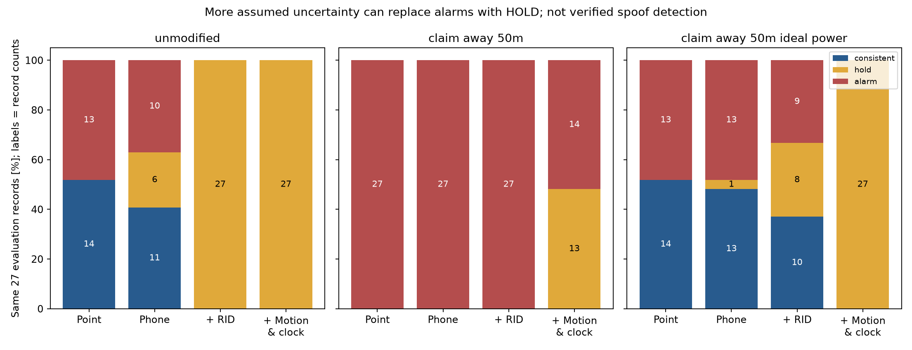
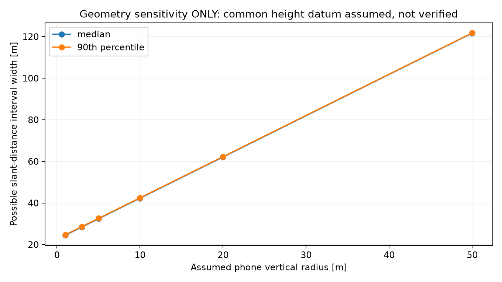

# 緯度経度・時刻・高度と誤差を含めた評価・試作回路

後続で[署名付き回路と合成1件のproof](../SIGNED_DESIGN.md)を実装・実行した。以下の「署名/proof未実施」は誤差対応段階または実データへの接続についての記録。実データのモデル・高度精度不足は解決していない。

2026-11-24。Week29の保存原本を読み取り専用で再監査し、既存の評価27行とモデルを固定して実行した。**実際の位置誤差や位置偽装の検出率を測れたという結果ではない。** 誤差半径を仮定した場合のモデル判定と、その計算を制約する回路の実装である。

## 1. データに何があったか

対象実機を受信したAndroidの324行（Pixel132、ASUS-1 146、ASUS-2 46）について、元DBと元Remote ID Packを監査した。

| 項目 | 実際に確認したこと | 限界 |
|---|---|---|
| 緯度・経度 | スマホとRIDに存在 | どちらも独立した位置真値ではない |
| 高度 | 全324行にスマホ楕円体高度、RID Geo/Baro高度・Heightを保持 | 高度値が存在することと、基準・バイアス・精度が共通なことは別 |
| スマホ水平精度 | 全324行で保存。Pixel132行の中央値約0.97m | OS推定値。最大実誤差の保証ではない |
| スマホ高度精度 | **対象324行に保存なし**。元の測位レコードにも該当フィールドなし | 水平精度を縦へ転用しない。現在のOS APIで取得可能でも過去ログへ補完しない |
| RID精度コード | 全324行が水平10、高度4、気圧高度4、時刻1 | 旧版定義では10m、10m、10m、0.1秒の申告。送信者が申告した値であって真値保証ではない |
| 時計の不確かさ | 対象324行の`time_uncertainty_ms`は未設定 | RID毎時時刻のepoch・相対時計差を確定したとはしない |

Androidの水平/高度精度は68パーセンタイルの推定であり、確定した誤差上限ではない。1/2/3倍を使っても、データの分布を検証せずに95%/99%区間と呼ばない。[Android Location公式仕様](https://developer.android.com/reference/android/location/Location#getAccuracy())

RIDの精度コードは固定した[2020年v0公式ヘッダ](https://github.com/opendroneid/opendroneid-core-c/blob/6b046f4af56b25ffc04dc5130c3308c697bab89c/libopendroneid/opendroneid.h)の定義を使用。Pythonの元バイト抽出を、同commitの`decodeLocationMessage`で**324/324一致**と照合した。unknown/reservedコードを誤差0へ変換しない。

初回は旧版のPack decoderがBasic ID重複を許さないため、全324件の照合が失敗し処理を停止した。元の実機PackにはBasic IDが2件ある。ライブラリ・本番parserを緩和せず、対象を**一意なLocationメッセージの精度コード**に限定した参照照合へ変更して再実行した。これは旧版のPack全体の受理・適合を確認した結果ではない。失敗ログも残した。

[監査JSON](results/run-a/audit-summary.json)

## 2. 水平位置誤差を含めた判定

学習52・校正26・評価27という既存分割と、`a=-30.175003…`, `n_h=3.110833…`, `tau=5.643584…dB`の既存モデルを変更していない。未改変13/27警報を再現できなければ停止する。

点としての距離dではなく、仮定した半径Eに対する`[max(0,d−E),d+E]`を考える。単調減衰モデルfに対し、可能な距離全てでRSSI残差が閾値内なら「整合」、全てで外なら「警報」、どちらの可能性もあれば「保留」。距離下限が0ならlog(0)や勝手な近距離丸めをせず保留する。

| 未改変の同じ27件 | 整合 | 警報 | 保留 |
|---|---:|---:|---:|
| 点距離（従来） | 14 | 13 | 0 |
| スマホ水平精度×1を半径と仮定 | 11 | 10 | 6 |
| スマホ水平精度×3を半径と仮定 | 5 | 9 | 13 |
| スマホ×1＋RID申告10mを半径と仮定 | 0 | 0 | 27 |

警報0件でも正常を正しく証明できたのではなく、全件保留である。RID申告の精度をそのまま信頼すると、攻撃者が大きな精度値を申告して判定を曖昧にできる。採用時には誤差の出所・許容上限・承認方針を署名/検証条件へ結合する必要がある。

50m遠方申告変更は、スマホ精度×1/2/3のみでは27/27警報のまま。ただし全件が元の学習距離域外であり、未改変も安定して判定できていない。実機攻撃の検出成功率とはしない。



[水平精度倍率のグラフ](results/run-a/01_horizontal_uncertainty.png)、[13設定×3条件のCSV](results/run-a/sensitivity.csv)。位置変更・電力補償は後処理の合成。元RSSI・位置・精度は保存済み値を使う。独立runのCIは出していない。

## 3. 時刻ずれを位置誤差へ反映

条件付きの追加半径を、`仮定速度上限 ×（実測した自己位置fixとの時刻差＋RID申告時刻精度0.1秒＋仮定時計差）`とした。速度は5/15m/s、時計差は0/0.5/2秒。値は校正結果ではなく感度分析の設定である。

例えばスマホ精度＋RID10m、15m/s、追加時計差2秒の条件では、50m遠方への合成位置変更の27件は警報14・保留13となった。理想電力補償を加えた場合は全27件保留。時計・動きの不確かさを広く置くと、検査できる条件が減ることを示す。

RID時刻を受信機時刻へ確定対応させた結果ではない。実際の全時計誤差を使った判定は`NOT_EVALUABLE`。受信時刻とGPS fixの同端末内の差だけは保存済み単調時計から利用した。

[時刻感度グラフ](results/run-a/02_time_budget_sensitivity.png)

## 4. 高度誤差の感度分析

スマホの高度精度が未保存なので、1/3/5/10/20/50mを**仮定**し、RID側の申告10mと合わせた。共通の高度基準だと仮定した場合の距離範囲だけを計算した。未検証の仮定を付けずに3D真距離・高度偽装検出へ利用しない。

水平距離の範囲を`[h_min,h_max]`、高度差の絶対値をz、合計縦半径をEvとして、

`d_min = hypot(h_min, max(0,z−Ev))`

`d_max = hypot(h_max, z+Ev)`

この27件では、仮定スマホ高度半径1mなら斜距離区間幅の中央値は約24.48m、10mなら約42.30m、50mなら約121.68m。これは**実際の位置誤差ではなく、仮定した誤差から作った距離範囲の幅**である。水平RSSIモデルへ斜距離を代入する評価は行っていない。



[高度感度CSV](results/run-a/height-sensitivity.csv)

## 5. 追加した回路

[`UncertaintyCircuit`](../uncertainty.go)は従来試作と別のstatement/domain。公開Mode3Dで2D/3Dを区別する。合成の距離帯RSSI区間を使った計算制約であり、実測logモデルをそのまま証明したものではない。

- private：観測者の局所座標、受信/申告位置の軸別誤差、RSSI、受信時刻、自己位置fix時刻、時計誤差、既知フラグ、nonce。
- public：申告位置/時刻、run・座標系・claim token、2D/3Dの区別、承認予定のモデル・時間/速度方針、整合/警報/保留、commitment。
- 時間半径：`ceil(MaxSpeedCMS × (|t_rx−t_fix|+|t_rx−t_claim|+ClockErrorMS)/1000)`を整数制約で検査。実測がない速度上限・時計差は仮定であり、真実性を証明しない。
- 軸iの絶対差をdi、誤差の合計をeiとし、最小差`max(0,di−ei)`、最大差`di+ei`から距離二乗の範囲を計算。
- 交差する全距離帯で判定が一致すれば整合/警報、混在なら保留。精度や時刻が不明、3Dで高度基準/縦誤差が不明なら保留。
- 時刻は共通epochのミリ秒48bit。RID毎時時刻をそのまま投入しない。既知な時刻でも回路表現範囲を超える時間/移動半径はアダプタで評価不能とする。

座標中心は20bit cm、各位置誤差/時間半径も20bit。軸最大差は`4(2^20−1)`、三次元二乗和は46bit未満。新境界上限を固定し、有限体wraparoundを避ける。

合成25ケース成功、119,990制約。前の回路44ケースも維持。高度が不明なのに3D整合を主張する入力、誤差を無視した判定、時間半径の不正な切上げ、元commitmentを維持した誤差/時計変更を拒否した。**実データのproof生成・署名結合は未実施**。

`geometry.py`は緯度経度をWGS84 ECEF→局所ENUへ正規化するための幾何アダプタ。2Dは楕円体上への射影であり高度0を実測値と扱わない。3Dは両者の高度・高度精度・確認済み共通基準を必須とし、不足時は停止する。射影の許容誤差も明示入力とし、座標cm量子化の分を外向きに追加する。正規化自体は回路外であり、元緯度経度と局所座標の結合はまだ署名/検証へ接続していない。

## 6. テスト・再現・残件

```sh
# リポジトリルート
python3 -m unittest discover -s week_tmp/circuit-design/uncertainty -p 'test_*.py' -v
cc -std=c11 -O2 -I .cache/week30-odid-v0-reference \
  week_tmp/circuit-design/uncertainty/accuracy_probe.c \
  .cache/week30-odid-v0-reference/opendroneid.c -lm -o .cache/week30-accuracy-probe
.cache/week26-mac-venv/bin/python week_tmp/circuit-design/uncertainty/evaluate.py \
  --raw-config captures/week29/research-raw-input-private.json \
  --positions-config captures/week29/research-input-private.json \
  --selection-manifest captures/week29/issue89-quality-manifest-a/selection-private.json \
  --reference-probe .cache/week30-accuracy-probe \
  --private-output captures/week_tmp/NEW_RUN \
  --output week_tmp/circuit-design/uncertainty/results/NEW_RUN
.cache/week26-mac-venv/bin/python week_tmp/circuit-design/uncertainty/render_status.py \
  week_tmp/circuit-design/uncertainty/results/NEW_RUN
cd week_tmp/circuit-design
DRAFT_SUMMARY_PATH=results/constraint-summary.json go test -count=1 -v ./...
```

入力/出力の私的パスはignored captures内のみ、owner-onlyを確認する。実行時のDB・参照ログ・位置CSV・固定マスクはhash不変を確認。個票と入力hash一覧はprivate出力に0600、ディレクトリ0700で保存。公開成果は匿名集計と図だけであり、入力データは配布しない。参照ソースは上記固定commitを別途取得する。

Pythonの幾何・判定・未知精度・境界は27テスト成功。既存UAV98件、aggregator Go、contracts48件も成功（Goの既存パッケージはcache利用）。画像4枚を目視確認した。

次に必要なのはスマホ高度精度の今後の保存、共通高度基準の確認、RID時計のepoch/受信時計差の確認、独立真値・独立run、モデルの採否、署名/資格/方針と回路入力の結合。今回の回路追加だけでこれらを完了扱いにしない。
